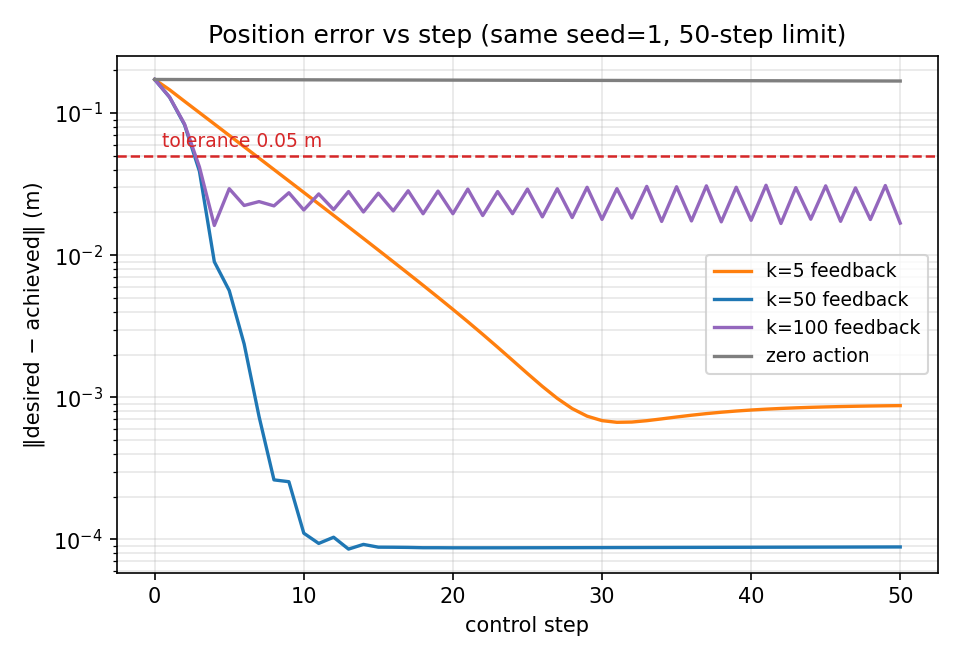
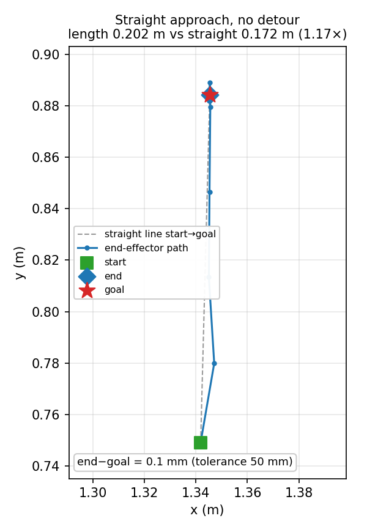

# W5 讲义：从零看懂 MuJoCo 与 FetchReach 基线实验

> 面向：没接触过 MuJoCo、也没写过仿真代码的人。
> 目标：读完能回答三个问题——**MuJoCo 在替我做什么？我控制了什么？这些图和数据说明了什么？**
> 所有数字都是本仓库 `./.venv` 里实际跑出来的，不是抄的。

---

## 0. 这份讲义怎么用

建议分四次读，每次 40–50 分钟，读完立刻在终端敲一遍对应命令。

| 次 | 读哪几节 | 动手做什么 | 读完应该能说出 |
|---|---|---|---|
| 1 | 第 1 章 | 跑一次「解剖脚本」 | MuJoCo 里 qpos/qvel/ctrl 是什么，FetchReach 为什么没有电机 |
| 2 | 第 2 章 | 写一个 20 行的最小闭环 | `reset/step` 五元组、`terminated` 与 `truncated` 的区别 |
| 3 | 第 3–4 章 | 跑 `check_env.py`、`fetchreach_baseline.py` | 四个实验分别在验证什么 |
| 4 | 第 5–6 章 | 对着两张图讲一遍结论 | 图里每条线为什么长那样，结论的边界在哪 |

前置：仓库根目录、`.venv` 已装好（见 README「W5」一节）。

```bash
cd ~/embodied-learning
./.venv/bin/python scripts/check_env.py      # 先确认环境是通的
```

---

## 1. MuJoCo 是什么

### 1.1 一句话

MuJoCo = **一个用 C 写的物理引擎** + **一个 Python 包（`import mujoco`）**。
你给它一个 `.xml` 描述的「世界」（有哪些刚体、关节、质量、约束），它按固定时间步反复算：
**在当前状态下，各关节会被力/约束推到哪去**。

它本身**不是**强化学习库，也**没有**「环境」「回合」「奖励」这些概念。
这些是 Gymnasium（`gym.make(...)`）在外面包的一层。这个分层一定要先分清，否则看代码会一直混。

```text
你的策略代码  →  Gymnasium 接口（reset/step/reward）  →  MuJoCo（mj_step 算物理）
```

### 1.2 三个对象：model / data / ctrl

MuJoCo 的 API 只有三个核心对象，所有代码都是围着它们转：

| 对象 | 是什么 | 典型字段 | 生命周期 |
|---|---|---|---|
| `MjModel` | **世界的定义**（只读）。有几根杆、质量多少、时间步多大 | `nq` `nv` `nu` `njnt` `nmocap` `neq` `opt.timestep` | 加载后不变 |
| `MjData` | **某一时刻的状态**（可读写）。关节角、速度、末端位置 | `qpos` `qvel` `ctrl` `mocap_pos` `site_xpos` | 每步都在变 |
| `mujoco.mj_step(model, data)` | **推进一步物理**（内部积分 + 解约束 + 碰撞） | — | 调一次 = 前进 `timestep` 秒 |

最小可运行程序（不经过 Gymnasium）：

```python
import mujoco
model = mujoco.MjModel.from_xml_path("scene.xml")   # 读模型
data  = mujoco.MjData(model)                        # 建状态
for _ in range(100):
    data.ctrl[:] = 0.0        # 给执行器下指令（这个模型可能没有执行器）
    mujoco.mj_step(model, data)
print(data.qpos)              # 100 步之后的关节位置
```

这就是 MuJoCo 的「基本用法」。剩下的全是细节。

### 1.3 怎么读 MJCF（.xml）

MJCF 是 MuJoCo 的模型格式。以本仓库真正在用的
`.venv/lib/python3.12/site-packages/gymnasium_robotics/envs/assets/fetch/reach.xml` 为例，去掉噪声后只有这些：

```xml
<mujoco>
  <option timestep="0.002"/>                 <!-- 物理步长 2 ms -->
  <worldbody>
    <geom type="plane" .../>                 <!-- 地面 -->
    <body name="floor0"><site name="target0" pos="0 0 0.5"/></body>
    <include file="robot.xml"/>              <!-- 7 自由度 Fetch 机械臂 -->
    <body name="table0" .../>                <!-- 桌子 -->
  </worldbody>
</mujoco>
```

`robot.xml` 里最关键的两段：

```xml
<!-- 1) 一个「不受物理影响」的标记体，位置由你直接写 -->
<body mocap="true" name="robot0:mocap" pos="0 0 0"> ... </body>

<!-- 2) 把 mocap 和真实的夹爪焊在一起：让夹爪去追 mocap -->
<equality>
  <weld body1="robot0:mocap" body2="robot0:gripper_link"
        solimp="0.9 0.95 0.001" solref="0.02 1"/>
</equality>
```

需要认识的名词：

| 标签 | 作用 | 在 FetchReach 里 |
|---|---|---|
| `<body>` | 刚体，可嵌套成树 | `base_link → torso → shoulder → … → gripper_link` |
| `<joint>` | 关节，决定 body 能怎么动 | 15 个（7 个手臂 + 躯干升降 + 头 2 + 手指 2 + 底座 3 个锁死滑轨） |
| `<geom>` | 碰撞/显示形状 | 大量 mesh |
| `<site>` | **没有质量、没有碰撞**的坐标系标记点 | `robot0:grip` = 末端参考点 |
| `<mocap>` | 运动学标记体，**不受重力和碰撞**，可被代码直接赋值 | 目标点 |
| `<equality><weld>` | 等式约束：把两个 body 拉在一起 | mocap ↔ 夹爪 |
| `<actuator>` | 电机/位置伺服（真正的「控制输入」） | **这个模型里一个都没有** |

### 1.4 时间：为什么一步是 0.04 秒

`reach.xml` 里 `timestep="0.002"`，但 Gymnasium 的 `step()` 里跑了 20 次 `mj_step`：

```text
控制周期 = 0.002 s × 20 substeps = 0.04 s  →  控制频率 25 Hz
```

这两个时间尺度要分清：

- **物理步长 0.002 s**：数值积分精度，越小越准越慢；
- **控制步长 0.04 s**：你的策略每 40 ms 才能改一次动作。

本仓库实验里说的「50 步上限」指的是 **50 个控制步** = 2 秒仿真时间。
图上的横轴 `control step` 也是这个。

### 1.5 全篇最重要的一条：FetchReach 没有电机

先看实测（第 1.6 节有脚本）：

```text
nq, nv, nu = 15 15 0      ← nu = 0：模型里没有任何执行器
nmocap = 1                ← 有一个 mocap 标记体
neq = 1                   ← 有一个等式约束
timestep = 0.002, n_substeps = 20, 控制周期 = 0.04 s
```

`nu = 0` 意味着：**这个环境里没有「力矩」「电机角度」这种控制量**。
那机械臂为什么能动？看环境源码
(`gymnasium_robotics/envs/fetch/fetch_env.py:86-106` 和 `utils/mujoco_utils.py:51-71`)：

```python
# 1) 动作先乘 0.05，得到「这一小步想往前挪多少米」
pos_ctrl, gripper_ctrl = action[:3], action[3]
pos_ctrl *= 0.05
...
# 2) 把 mocap 往前挪这么多
data.mocap_pos[:] = data.mocap_pos + pos_delta
# 3) 然后 mj_step：weld 约束把夹爪往 mocap 拉
```

所以整条链路是：

```text
你的动作 a（4 维，无量纲）
  → mocap 目标位置 += 0.05·a[:3]
  → MuJoCo 的等式约束求解器拖着整条手臂去够这个目标
  → 关节怎么转、每个关节多大力，全部由求解器算
```

**这就是「不是我写的代码在替我做事」的含义。**
你控制的是「目标点每步挪多少」，不是「关节转到哪」，也不是「电机出力多少」。
反过来说：手臂一个控制步**追不满**这个目标，所以实际位移 < 命令位移。这个折扣率就是后面反复出现的 `r`。

### 1.6 亲手解剖一次

把下面存成 `/tmp/probe.py` 跑（或直接复制进终端）：

```python
import gymnasium as gym, gymnasium_robotics, numpy as np
gym.register_envs(gymnasium_robotics)
env = gym.make("FetchReach-v4", max_episode_steps=50)
u = env.unwrapped

print("nq, nv, nu:", u.model.nq, u.model.nv, u.model.nu)
print("timestep / n_substeps / 控制周期:",
      u.model.opt.timestep, u.n_substeps, u.n_substeps * u.model.opt.timestep)
print("关节:", [u.model.joint(i).name for i in range(u.model.njnt)])
print("执行器:", [u.model.actuator(i).name for i in range(u.model.nu)])
print("mocap 数:", u.model.nmocap, "位置:", np.round(u.data.mocap_pos, 4))
print("等式约束数:", u.model.neq)
print("末端 site 位置:", np.round(u.data.site("robot0:grip").xpos, 4))
env.close()
```

实测输出（本机）：

```text
nq, nv, nu: 15 15 0
timestep / n_substeps / 控制周期: 0.002 20 0.04
关节: ['robot0:slide0', 'robot0:slide1', 'robot0:slide2', 'robot0:torso_lift_joint',
      'robot0:head_pan_joint', 'robot0:head_tilt_joint', 'robot0:shoulder_pan_joint',
      'robot0:shoulder_lift_joint', 'robot0:upperarm_roll_joint', 'robot0:elbow_flex_joint',
      'robot0:forearm_roll_joint', 'robot0:wrist_flex_joint', 'robot0:wrist_roll_joint',
      'robot0:r_gripper_finger_joint', 'robot0:l_gripper_finger_joint']
执行器: []
mocap 数: 1 位置: [[1.3418 0.7491 0.555 ]]
等式约束数: 1
末端 site 位置: [1.3418 0.7491 0.5347]
```

能读出的三件事：

1. `nq = nv = njnt = 15`：15 个自由度，且**没有浮动基座**（底座 3 个滑轨被 `damping=1e11` 焊死了）；
2. `nu = 0`：没有电机。手臂是「被约束拖着走」的被动机构；
3. `mocap` 的 z 比末端 site 高 2 cm（0.555 vs 0.5347）：weld 只约束相对位姿，`mocap` 就是那个「目标把手」。

---

## 2. 从 MuJoCo 到 Gymnasium：多出来的那一层

### 2.1 `step()` 返回五个东西

```python
obs, reward, terminated, truncated, info = env.step(action)
```

| 返回值 | 含义 | 本任务实际值 |
|---|---|---|
| `obs` | 观测（这里是 `dict`） | 见 2.2 |
| `reward` | 奖励 | sparse：成功 0，否则 −1 |
| `terminated` | **任务真的结束了**（成功/失败/翻倒） | **恒 False**（到点也不结束） |
| `truncated` | **时间到了被截断** | 第 50 步为 True |
| `info` | 附加信息 | `{"is_success": bool}`，**当步**是否在容差内 |

`terminated` 和 `truncated` 必须分开，这是写 RL 代码最容易错的地方：
前者要「自举终止」，后者是「超时截断」，处理方式不同。

这个任务还有个反直觉点：**成功了也不结束**（continuing task），
所以「成功率」必须先定义口径，否则同一个实验能报出三个不同的数。

### 2.2 观测是一个字典（GoalEnv 风格）

```python
obs = {
  "observation":    (10,),  # 末端位置3 + 手指开合2 + 末端线速度3 + 手指速度2
  "achieved_goal":  (3,),   # 当前末端位置
  "desired_goal":   (3,),   # 本回合目标位置
}
```

为什么要拆成三份？因为强化学习里「状态」和「目标」要能分开换：
同一套策略换一个目标还能用。`achieved_goal` 和 `observation[:3]` 在 **FetchReach 里完全相等**
（`check_env.py` 实测 `True`），但换成 FetchPush 就不等了（那时它是方块的位置）。
**不要把这个特例当通例。**

### 2.3 读 `scripts/w5_core.py`（166 行，整个 W5 的骨架）

这个文件只做四件事，后面所有脚本都 import 它，保证「成功」的定义只有一份。

**(a) 造环境（第 22–24 行）**

```python
def make_env(render_mode=None, max_episode_steps=50):
    gym.register_envs(gymnasium_robotics)   # gymnasium>=1.0 必须显式注册
    return gym.make(ENV_ID, render_mode=render_mode, max_episode_steps=max_episode_steps)
```

`gym.register_envs` 这行漏了会报 `NameNotFound: FetchReach-v4`，这是新手第一个坑。

**(b) 策略就是一个函数（第 43–55 行）**

```python
def make_policy_feedback(k):
    def policy(obs, info):
        error = obs["desired_goal"] - obs["achieved_goal"]   # 注意符号！
        a = np.zeros(4, dtype=np.float32)
        a[:3] = np.clip(k * error, -1.0, 1.0)
        return a
    return policy
```

全部控制逻辑就这 5 行：
**误差 → 乘增益 → 裁剪到 [−1,1] → 作为动作下发**。
`a[3]=0` 只是可读性，第 4 维在本任务被内部强制清零（实测只改它，轨迹差值 = 0.0）。

**(c) 跑一个回合并同时记两种成功口径（第 59–102 行）**

```python
success_end  = bool(info["is_success"])              # 末步是否在容差内（环境口径）
success_ever = first_success_step is not None       # 回合内是否曾经进过容差（你的口径）
```

**(d) 采集逐步数据（第 105–151 行）**

关键在顺序：**先拷贝 `obs`，再 `step`**。

```python
a = policy(obs, info)
before = {k: v.copy() for k, v in obs.items()}   # 先存
obs, ... = env.step(a)                            # 再走
```

顺序反了就会把「执行后的状态」当成「执行前的输入」存下来——W6 训行为克隆时模型会学到「用结果预测原因」，训练损失很好看，一闭环就崩。

### 2.4 你也能写：20 行最小闭环

```python
import gymnasium as gym, gymnasium_robotics, numpy as np

gym.register_envs(gymnasium_robotics)
env = gym.make("FetchReach-v4", max_episode_steps=50)
obs, info = env.reset(seed=0)

for t in range(50):
    err = obs["desired_goal"] - obs["achieved_goal"]
    a = np.zeros(4, dtype=np.float32)
    a[:3] = np.clip(50 * err, -1, 1)          # k=50 的位置反馈
    obs, r, term, trunc, info = env.step(a)
    d = np.linalg.norm(obs["desired_goal"] - obs["achieved_goal"])
    print(f"t={t:2d}  d={d:.4f} m  success={info['is_success']}")
    if term or trunc:
        break
env.close()
```

跑完你会看到误差 3 步之内掉到 2 cm 以下，然后基本不动——这就是「专家轨迹」的由来。

---

## 3. 仓库这次到底加了什么

`git status` 里未跟踪/修改的文件，按用途分四组：

```text
环境事实        scripts/check_env.py
共享骨架        scripts/w5_core.py
实验入口        scripts/fetchreach_baseline.py     ← 接口断言 + 单轴 + 扫 k + 三策略
                scripts/collect_trajectories.py    ← 20 条专家轨迹
                scripts/verify_trajectories.py     ← 6 项数据核对
                scripts/plot_w5.py                 ← 两张图
数据            data/raw/feedback_seed0..19.npz    ← 20 回合 × 50 步 = 1000 样本
结果            outputs/w5/k_sweep.csv
                outputs/w5/k_sweep_summary.csv
                outputs/w5/baseline_results.csv    ← 60 行
                outputs/w5/error_curve.png
                outputs/w5/path_xy.png
笔记            notes/W5_接口核对表.md
                notes/W5_逐项核对记录.md
                notes/W5_周报草稿.md
配置            requirements.txt（锁 mujoco==3.11.0 等）、.gitignore（+.venv/）、README（+W5 一节）
```

调用关系（记住这张图，比读 500 行代码有用）：

```text
check_env.py ──────────────┐  打印事实，填「接口核对表」
                           │
                           ├─ 结论：动作=目标位移比例(×0.05)、r≈0.63、nu=0、
                           │         terminated 恒 False、is_success 是当步
                           ▼
fetchreach_baseline.py ── w5_core.py ── 扫 k（7×20 回合）→ k_sweep*.csv
                           │           三策略（3×20 回合）→ baseline_results.csv
                           ▼
                     选定 k=50
                           │
collect_trajectories.py ───┘  20 条 npz
                           │
verify_trajectories.py ────┘  6 项核对（数据能不能用）
                           │
plot_w5.py ────────────────┘  2 张图（给结论配图）
```

设计上有一个好习惯值得学：**`run_episode` 只写一遍**。
如果基线脚本和采数据脚本各写一份回合循环，两边的「成功」定义迟早会漂移，到时候数字对不上，你还得花半天找原因。

---

## 4. 四个实验：做了什么、为什么这么做

### E1 接口核对（`check_env.py`）

**问题**：这个环境到底长什么样？我的假设哪些是错的？

它不是「跑实验」，而是**测事实**。脚本只打印，不下结论，因为「r≈0.6」这种数必须本机打出来，抄别人的等于没做。

三个必须记住的实测结果：

| 事实 | 实测 | 为什么重要 |
|---|---|---|
| 动作语义 | `a[:3]` 是「目标位移比例」，内部乘 0.05；第 4 维完全无效 | 决定你写策略时乘什么、乘多少 |
| 命令 ≠ 位移 | `a=0.5` 每步命令 0.025 m，实际 0.0152→0.0165→…（r 首步 0.608、稳态 0.646） | 后面所有定量预测都要乘 r |
| 回合结束方式 | 50 步 `truncated`，`terminated` 恒 False；`is_success` 是当步 | 决定「成功率」怎么定义 |

还有两个补充实测（计划书里没写，但会改结论）：

1. `a=1.0` 连走 10 步，每步位移 `0.0304 → 0.033 → 0.0325 → … → 0.024`：**不是严格常数**，前 5 步≈0.031 m，之后因构型变化缓降。所以引用时写「前 5 步约 3.1 cm」，不要写「严格常数」。
2. 零动作 5 步仍有毫米级漂移（`(0.1, 0.0, -0.8) mm`）：末端在向「不动的 mocap」收敛。量级远小于 5 cm 容差，不影响「零动作 0/20」的结论。

### E2 单轴 + 扫增益 + 三策略（`fetchreach_baseline.py`）

**问题 1（单轴）**：只动一个轴，另外两个轴会不会跟着动？
实测 `+x` 5 步总位移 `(0.0805, 0.000, −0.0007)`：几乎只有 x 变 → 确认是**笛卡尔空间**控制，不是关节角控制。

**问题 2（扫增益）**：k 取多少最好？为什么？
7 个 k × 20 回合，同一组 seed（0–19）。结果：

| k | success_ever | success_end | 首次达标步数（均值） | 末距均值 |
|---|---|---|---|---|
| 1 | 20/20 | 20/20 | 31.45 | 27.1 mm |
| 2 | 20/20 | 20/20 | 15.75 | 6.2 mm |
| 5 | 20/20 | 20/20 | 6.25 | 2.2 mm |
| 10 | 20/20 | 20/20 | 3.25 | 1.8 mm |
| 20 | 20/20 | 20/20 | 2.60 | 1.6 mm |
| **50** | **20/20** | **20/20** | **2.55** | **1.36 mm** |
| 100 | 20/20 | 20/20 | 2.60 | **22.2 mm**（变差） |

这张表有两个「反常识」，都是这周最重要的收获：

- **成功率全是 20/20**。不是代码写错了，是 5 cm 容差相对这台机械臂太宽松。结论要写成「成功率对该任务不敏感，改用首次达标步数和末距区分」，而不是「扫增益没意义」。
- **k=100 更猛，结果更差**。末距从 1.4 mm 反弹到 22 mm，因为增益越过了稳定边界（第 6.3 节给推导）。

**问题 3（三策略）**：反馈策略的 20/20 是不是白送的？
同一组 20 个起点/目标：

| 策略 | success_ever | success_end | 末距均值 |
|---|---|---|---|
| 零动作（下界） | **0/20** | 0/20 | 144.5 mm |
| 随机动作（稻草人） | **3/20** | **0/20** | 234.1 mm |
| 位置反馈 k=50 | **20/20** | **20/20** | 1.4 mm |

随机策略有 3 次「瞎碰进过容差」，但没有任何一次在第 50 步还在容差内——
这就是为什么两个口径都要报：`success_ever` 会高估随机策略，`success_end` 会低估「到过点」的能力。

有了 `0/20` 这个分母，`20/20` 才有意义。以后报 95% 成功率，第一个问题一定是「基线多少」。

### E3 轨迹采集（`collect_trajectories.py`）

**问题**：W6 要训行为克隆，训练数据从哪来？标签怎么对齐？

用 k=50 的反馈策略当「专家」，跑 20 个回合，一回合存一个 `npz`：

```python
z = np.load("data/raw/feedback_seed0.npz")
z.files
# ['desired_goal','episode_id','obs_before','achieved_before','action','obs_after',
#  'achieved_after','step','terminated','truncated','is_success']
z["action"].shape     # (50, 4)
```

每条样本是 `(obs_before[t], action[t])` 这一对。
`desired_goal` 单独存一份，是为了以后只靠数据就能重画误差曲线。

### E4 数据核对（`verify_trajectories.py`）

**问题**：这 1000 条数据，凭什么相信它？

模拟器采集的数据不会有「标注错误」，但会有**对齐错误**和**语义误解**，
而且错得很安静——不核对就直接训练，损失曲线照样下降。

6 项检查（标准写在 `notes/W5_逐项核对记录.md`）：

| # | 检查 | 通过标准 | seed=0 实测 |
|---|---|---|---|
| 1 | `obs_before[t] == obs_after[t-1]` | max diff < 1e-12 | **0.0**（逐位相等） |
| 2a | 首步 `Δachieved` 与 `action[:3]` 同向 | < 1° | 0.38° |
| 2b | 跟踪步方向中位数 | < 5° | 2.80° |
| 3 | 比例 `‖Δachieved‖/(0.05‖a‖)` | 中位数 ∈ [0.4, 0.9] | 0.634 |
| 4 | 结束标记有且只在最后一步 | 恰好 1 个 True | 49/49，`truncated` |
| 5 | `step` 从 0 连续 | 不跳号 | OK |
| 6 | 所有 action 在 [−1,1] | max ≤ 1 | 1.000 |

20 条全部 PASS。其中第 1 项是**防标签泄漏**的关键：
它保证输入是「执行前」的观测，而不是「执行后」的。

第 2、3 项有个实现细节值得学：**只能在「末端真的动了」的步上统计**。
一条 50 步的专家轨迹里，真正在走的只有 3–7 步（k=50 第 3 步就收敛），
其余步是「停在容差内微调」，动作量 < 0.05，方向由舍入噪声主导。
把这些步算进去，seed=0 会被误判成「方向 156°、比例 0.02」——那是**没动**，不是方向反了。

---

## 5. 两张图怎么看

先记住一条总原则：**一张图只支持一个 claim**。
标题写的就是 claim，图里所有元素都为它服务。读图时先找「这句话是什么」，再看「证据够不够」。

### 5.1 `outputs/w5/error_curve.png`（误差-步数曲线）



标题：`Position error vs step (same seed=1, 50-step limit)`
一句话 claim：**k=50 最快且稳定收敛；k=100 会抖；k=5 慢但也在收敛；零动作不动。**

逐要素读：

| 图上的元素 | 怎么读 | 说明了什么 |
|---|---|---|
| 横轴 `control step` 0–50 | 50 个控制步 = 2 s 仿真时间 | 上限是 `truncated`，不是任务失败 |
| 纵轴 `‖desired − achieved‖ (m)`，**对数刻度** | 每下降一格是「小 10 倍」 | 用对数是因为要同时看 1e-1 和 1e-4：线性轴会把 1 mm 以下的差别全压成一条线 |
| 红色虚线 `tolerance 0.05 m` | 成功判据 | 曲线穿到虚线**下方**那一步 = 首次达标步 |
| 灰色 `zero action` 平在 0.16 | 基线 | 不下发动作，末端几乎不动（只有毫米级漂移），误差 = 初始距离 |
| 橙色 `k=5` | 单调下降，第 7 步穿线，第 30 步到 1 mm | 增益小 → 慢，但不过冲 |
| 蓝色 `k=50` | 第 3 步穿线，之后一路降到 1e-4 | 快且稳，所以选它当专家 |
| 紫色 `k=100` | 一开始就穿线，但**在 0.02–0.03 m 之间来回锯齿**，始终下不去 | 增益过大 → 每步过冲、反号，形成极限环 |

紫色为什么是锯齿而不是「更快到底」？
因为离散步的误差更新是 `e ← (1 − 0.05·r·k)·e`。
k=100、r≈0.63 时系数 ≈ **−2.15**：误差每步**放大 2 倍并且反号**，于是越过目标、再越回来。
放大到被 5 cm 的单步位移上限卡住，就在 2–3 cm 之间稳定振荡。
它仍然「成功」（2–3 cm < 5 cm 容差），但精度从 1.4 mm 掉到 22 mm。
**只看成功率永远发现不了这个问题**——这正是图上那条紫线存在的意义。

读图时容易犯的错：

- 把对数轴的「直线下降」读成「匀速」：对数轴上的直线是**指数收敛**，每步缩同样的比例；
- 看到紫线在红线下方就说「k=100 最好」：要同时看它有没有在收敛；
- 忽略灰线：没有基线，你不知道 0.16 到 0.001 是「控制器的功劳」还是「任务本来就简单」。

### 5.2 `outputs/w5/path_xy.png`（末端路径图）



标题：`Straight approach, no detour` / `length 0.202 m vs straight 0.172 m (1.17×)`
一句话 claim：**末端基本走直线靠近目标，不绕路。**

| 元素 | 含义 |
|---|---|
| 绿色方块 `start` | 起点（reset 后的末端位置） |
| 红色五角星 `goal` | 目标 |
| 蓝色菱形 `end` | 第 50 步的末端位置 |
| 灰色虚线 | 起点→目标的直线，作为「理想路径」参照 |
| 蓝色折线 + 圆点 | 实际末端轨迹，每个点是一个控制步 |
| 左下角文字 | `end−goal = 0.1 mm`，容差 50 mm |

两个可直接引用的数：

- **路径长度 / 直线距离 = 1.17**：多走 17%，主要来自起手那一步的横向修正（图上 y≈0.78 附近那个折点），不是绕障；
- **末距 0.1 mm**：比容差小 500 倍。

注意这张图只有 5 个点：3 步就进容差，之后一直停在目标上，所以后面 47 步几乎重合。
**不要以为「点少 = 采样少」**，是收敛太快。

图里没有的东西也要能说出来：
它**不能**证明「控制律好」——只证明了这一个 seed 的几何形状。
通用性要看 20 条轨迹的统计（第 4 章 E4）。

### 5.3 读图通用清单

拿到任何一张实验图，按顺序问七个问题：

1. **标题的 claim 是什么？** 一句话，能复述。
2. **横纵轴是什么量、什么单位、什么尺度？**（线性/对数）
3. **参考线在哪？**（容差、0、理论值）
4. **基线在哪？**（零动作、随机、上一个版本）
5. **曲线形状属于哪类？** 单调收敛 / 过冲后收敛 / 振荡 / 发散 / 平台。
6. **图上的关键数字，表里能不能对上？**（对不上就是有一处错了）
7. **这张图不能说明什么？**（样本数、seed、只测了一个初始条件……）

**练习（答案在下一行）**

- Q1：k=5 在第几步首次进容差？ → 第 7 步（橙色线与红虚线交点）。
- Q2：为什么紫线一直在红线上方附近抖，却仍算成功？ → 它抖的范围 0.02–0.03 m **小于** 0.05 m 容差。
- Q3：灰线为什么不是完全水平？ → 零动作时 mocap 不动，但末端还在向它收敛，有毫米级漂移。

---

## 6. 结果的意义：五条结论

### 6.1 「0/20」比「20/20」更重要

零动作 0/20、随机 3/20（且末步 0/20），反馈 20/20。
前两个数字定义了分母，后一个才有解释力。
这是实验设计里最便宜、也最容易被省掉的一步。

### 6.2 成功率不敏感时，换指标

7 个 k 的 `success_ever` 全是 20/20，说明 5 cm 容差太宽松，成功率这个指标在这个任务上**没有分辨力**。
于是换两个有分辨力的：**首次达标步数**（看速度）和 **末距**（看精度）。
指标不是越"标准"越好，是要能区分你的假设。

### 6.3 一个公式预测了 7 组实验

从「误差 → 动作 → 位移」推一步：

```text
a_t   = clip(k·e_t, −1, 1)
Δx_t  ≈ r · 0.05 · a_t                 （r = 实测跟踪比 ≈ 0.63）
e_{t+1} = e_t − Δx_t
```

线性区（`k·e < 1`）里：

```text
e_{t+1} = (1 − 0.05·r·k) · e_t
```

两个结论：

| 条件 | 含义 | 代入 r=0.63 |
|---|---|---|
| `0.05rk < 1` | 单调收敛，不过冲 | k < 31.7 |
| `0.05rk < 2` | 稳定（可能过冲但会衰减） | **k < 63.5** |
| `0.05rk > 2` | 每步放大且反号 → 极限环 | k > 63.5 |

用初始距离均值 `d0 ≈ 0.145 m` 预测首次达标步数 `n ≈ ln(0.05/d0) / ln(1−0.05rk)`：

| k | 预测步数 | 实测步数 | 判断 |
|---|---|---|---|
| 1 | 33.2 | 31.45 | 吻合 |
| 2 | 16.3 | 15.75 | 吻合 |
| 5 | 6.2 | 6.25 | 吻合 |
| 10 | 2.8 | 3.25 | 接近（接近饱和区，离散误差变大） |
| 20 | 进入饱和区 | 2.60 | 由单步位移上限决定 |
| 50 | 稳定但过冲 | 2.55 | 最优 |
| 100 | 越过稳定边界 | 2.60，末距 22 mm | 与预测一致 |

**这就是"基线"的意义**：不是跑一组数放在那，而是先用一个可错的模型预测，
再让实验来打脸或确认。这里 7 组里 4 组误差 < 10%，边界位置（50 稳 / 100 抖）也对了。

顺带解释「为什么 k≥20 之后步数不再下降」：此时误差一大就饱和（`a=±1`），
每步位移上限固定为 `0.05·r ≈ 3.1 cm`，再大的增益也换不来更快的**物理**位移，
只会换来更大的过冲。

### 6.4 2 cm 的残差不是控制问题，是几何问题

20 条轨迹里，18 条末距 < 1 mm，但 seed0 是 19.9 mm。
查下去：目标 z=0.397 m，末端停在 z=0.4169 m 不再下降，
而 `torso_lift_joint` 的 qpos = 0.004，已经贴在关节下限（名义下限 0.039）。

结论：**目标 z 低于约 0.417 m 时，这个初始姿态够不到。**
动作早就饱和了，加大 k 也没用——卡的是工作空间，不是增益。

这条对写论文特别重要：

> 不要说「k=50 精度 1 mm」，
> 要说「绝大多数目标 1 mm 内，个别贴边目标受工作空间限制停在 2 cm 内」。

把「控制器能力」和「任务本身不可行」分开，是实验分析的基本功。
否则你会花一周去调一个根本调不动的参数。

### 6.5 这 1000 条数据能不能直接喂 W6

能跑通流程，但有两个已知风险，现在不解决，W6 会撞上：

1. **分布太窄**：专家 k=50 第 3 步就收敛，1000 条样本里大部分是「误差很小 → 几乎不动」。
   行为克隆会学到「不动」这个捷径，一换初始条件就失效（分布偏移）。
2. **量太少**：20 条 × 50 步 = 1000 个样本，够验证 pipeline，不够训出好策略。
   W6 需要加随机初始、多增益专家、甚至加噪声。

另外，`obs_before[t] == obs_after[t-1]` 逐位为 0，说明标签对齐是对的——
这一条如果错了，后面所有训练都是白做。

---

## 7. 常见错误与排查

| 现象 | 原因 | 处理 |
|---|---|---|
| `gym.make` 抛 `AssertionError`（无 message） | mujoco ≥ 3.12 与 gymnasium-robotics 1.4.2 不兼容 | `pip install mujoco==3.11.0`，别升 |
| `NameNotFound: FetchReach-v4` | 忘了 `gym.register_envs(gymnasium_robotics)` | 加这一行（gymnasium ≥1.0 必需） |
| 末端越走越远 | 误差符号写成 `achieved − desired` | 必须是 `desired − achieved` |
| 到点附近来回抖 | k 太大 | 按 `0.05·r·k < 2` 核算，先降到 10 或 5 |
| 50 步走不到 | k 太小，或 r 实测偏低 | 先确认 r，再调 k |
| `is_success` 一直 False 但看起来到了 | 判据是 5 cm；且只看当步 | 打印 `‖desired−achieved‖` 核对 |
| 所有 k 成功率都一样 | 正常，容差太宽松 | 改用首次达标步数和末距 |
| `obs_before[t] != obs_after[t−1]` | 在 `step` 之后才取 before | 先 `copy()` 再 `step` |
| `render_mode="human"` 报 GL/EGL 错 | 无显示环境 | 用 `None` 跑完；出图用 matplotlib `Agg` |
| 图存到 `scripts/outputs/` 里 | 用了相对路径且在 `scripts/` 下运行 | 脚本用 `Path(__file__).parents[1]` 定位仓库根 |

---

## 8. 术语速查

| 词 | 含义（在本项目语境下） |
|---|---|
| MJCF | MuJoCo 的 XML 模型格式 |
| `qpos` / `qvel` | 关节位置 / 速度，长度分别是 `nq` / `nv` |
| `ctrl` | 执行器指令；**本模型 `nu=0`，所以是空数组** |
| mocap | 不受物理影响的标记体，代码可直接写它的位置；本任务用它当"目标把手" |
| weld（等式约束） | 把两个 body 拉在一起的软约束；本任务靠它把夹爪拖向 mocap |
| substep | 一个控制步内部的物理步数，20 × 0.002 s = 0.04 s |
| `terminated` | 任务终止（成功/失败）；本任务恒 False |
| `truncated` | 超时截断；本任务第 50 步为 True |
| GoalEnv | 观测拆成 `observation/achieved_goal/desired_goal` 的环境约定 |
| `success_end` / `success_ever` | 末步在容差内 / 回合内曾进过容差 |
| 跟踪比 `r` | 实际位移 ÷ 命令位移，实测 0.60–0.65 |
| 极限环 | 误差不再收敛，在固定区间内反复振荡（k=100 的 2–3 cm） |

---

## 9. 自测 10 题

1. `nu = 0` 意味着什么？
2. 一个控制步是多少秒？怎么算出来的？
3. 动作 `a=[0.5,0,0,0]` 一步，mocap 前移多少？末端实际前移多少？
4. 为什么要存 `obs_before` 而不是 `obs_after`？
5. `success_ever` 和 `success_end` 在哪个策略上差别最大？说明了什么？
6. k=100 的误差曲线为什么是锯齿？
7. 为什么 `k=50` 的 `first_success_mean` 和 `k=20` 差不多？
8. seed0 的 2 cm 残差是控制器不好吗？
9. `path_xy.png` 里 1.17× 是什么意思？能说明什么、不能说明什么？
10. 如果明天要换 `FetchPush-v4`，这份代码哪一行最先会出错？

<details>
<summary>参考答案</summary>

1. 模型里没有执行器（电机/伺服）；手臂是被 mocap + weld 约束拖着动的。
2. 0.04 s = `timestep 0.002` × `n_substeps 20`，控制频率 25 Hz。
3. mocap 前移 0.025 m；末端实际约 0.015–0.016 m（r≈0.63）。
4. 防止把「执行后的状态」当「执行前的输入」，避免标签泄漏；否则 BC 闭环会崩。
5. 随机策略：3/20 vs 0/20。说明它偶尔瞎碰进容差，但停不住；两个口径都要报。
6. 增益越过稳定边界，误差每步放大 2.15 倍并反号，被单步位移上限卡住后形成 2–3 cm 极限环。
7. 进入饱和区后单步位移上限固定为 `0.05·r ≈ 3.1 cm`，增益再大也不能让物理位移更快。
8. 不是。目标 z=0.397 m 低于躯干能达到的最低末端高度（≈0.417 m），是工作空间限制。
9. 实际路径长度是直线距离的 1.17 倍，说明基本走直线、不绕路；只对这一个 seed 成立，不能证明控制律普遍好。
10. `_get_obs` / 目标定义：`achieved_goal` 不再是末端位置而是方块位置，`achieved_goal == observation[:3]` 不再成立；另外奖励和成功判据也要重读。

</details>

---

## 附：复现命令

```bash
cd ~/embodied-learning

# E1 接口事实
./.venv/bin/python scripts/check_env.py

# E2 断言 + 单轴 + 扫 k + 三策略（约几秒）
./.venv/bin/python scripts/fetchreach_baseline.py

# E3 采集 20 条专家轨迹
./.venv/bin/python scripts/collect_trajectories.py

# E4 数据核对（单条详查 / 20 条一览）
./.venv/bin/python scripts/verify_trajectories.py --seed 0
./.venv/bin/python scripts/verify_trajectories.py --all

# E4 两张图
./.venv/bin/python scripts/plot_w5.py
```

一句话收尾：

> **MuJoCo 负责「物理上会发生什么」，Gymnasium 负责「把这件事包装成能训练的接口」，你只负责「目标每步挪多少」。**
> **搞清楚这三层各管什么，比记住任何 API 都重要。**
