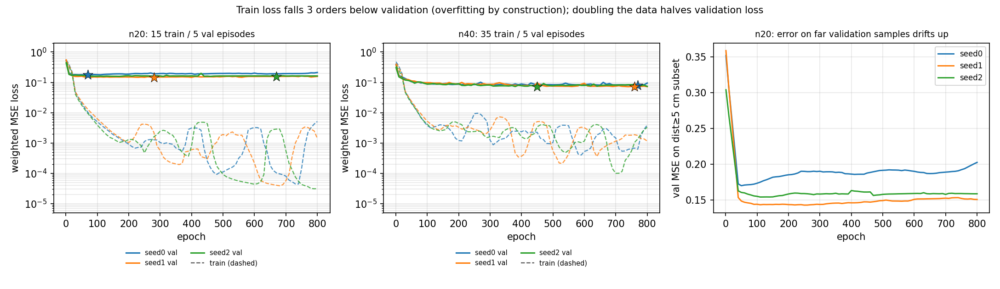
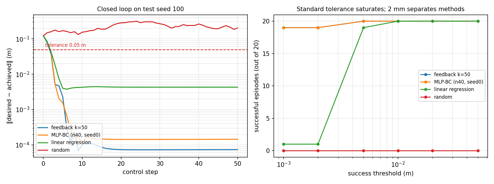

# 讲义：从零读懂行为克隆（BC）

> 配套代码：`src/bc_dataset.py`、`src/bc_model.py`、`scripts/train_bc.py`、`scripts/eval_closed_loop.py`、`scripts/plot_w6.py`
> 配套数据与结果：`data/raw/feedback_seed*.npz`、`outputs/w6/`
> 配套原始报告：`notes/W6_BC对照报告.md`（本讲义是它的"教学版"，数字全部来自同一批结果）

**读完你应该能回答三个问题**：
1. 模仿学习在数学上到底在解什么问题，它天生有什么毛病；
2. 这个仓库里从一条轨迹到一张评估表，每一步在干什么、为什么这么干；
3. 那两张图怎么看，看完能得出什么结论，以及这些结论**不能**推广到哪。

---

## 0. 先对齐术语（零基础必读）

| 术语 | 一句话解释 | 在本仓库的对应物 |
|---|---|---|
| 状态 / 观测 `obs` | 智能体此刻"看到"的东西 | FetchReach 的 10 维向量 + 目标点 |
| 动作 `action` | 智能体此刻"做"的事 | 4 维连续向量，前 3 维是末端位移比例 |
| 策略 `policy` `π` | 一个函数：观测 → 动作 | `make_policy_feedback`、`BCPolicy` |
| 回合 / episode | 从重置到结束的一次完整尝试 | 一次 `env.reset()` 到 `truncated` |
| rollout / 轨迹 | 一个回合里记录下来的 (观测, 动作) 序列 | `data/raw/feedback_seed*.npz` |
| 专家 | 提供示范的那个策略 | 位置反馈控制器 $a=\mathrm{clip}(50e)$ |
| 开环 / 闭环 | 动作不依赖实时反馈 / 依赖实时反馈 | 训练是开环评估，测试是闭环 |
| epoch / batch | 把训练集过一遍 / 一次梯度更新用的样本块 | 800 epoch，batch 256 |
| 过拟合 | 训练集背下来了，没见过的情况就崩 | 训练 loss 比验证低 3 个数量级 |
| 分布偏移 | 测试时见到的状态和训练时不一样 | 本讲义第 2.3 节，BC 的命门 |

---

## 1. 世界观：这个任务到底在做什么

**FetchReach-v4**：一个 7 自由度机械臂，末端要移动到一个随机生成的目标点。
判定成功：末端与目标距离 < **0.05 m**，每回合最多 **50 步**（超时算 `truncated`，成功**不会**提前结束）。

两个必须记住的接口事实（来自 W5 核对，见 `README.md`）：

- 动作 4 维，前 3 维是"末端目标位移的**比例**"，环境内部执行 `mocap += 0.05 * a[:3]`；第 4 维是夹爪，**在这个任务里完全无效**。
- **命令量 ≠ 实际位移**：命令 0.05 m，末端实际只走它的 **0.60–0.65 倍**（伺服跟踪有损耗）。

第二条很关键，后面解释"为什么线性回归会卡在 4 mm"要用到。

---

## 2. 模仿学习是什么

### 2.1 拿到策略的三条路

| 路线 | 需要什么 | 代价 |
|---|---|---|
| 手工设计（控制） | 领域知识 + 调参 | 任务一变就重写 |
| 强化学习 RL | 一个奖励函数 + 海量试错 | 采样极贵，奖励难设计 |
| **模仿学习 IL** | **一批专家示范** | 需要专家；专家错了学不会 |

模仿学习的假设极其朴素：**如果我能复现专家在每个状态下的动作，我就能复现专家的行为。**

RL 要知道"这个动作用了多少分"，IL 只要知道"专家在这里做了什么"。所以在机器人领域，示教（人拖拽、遥操作、脚本控制器）往往比设计奖励容易，IL 因此很常用。

### 2.2 行为克隆（BC）的定义

BC 是模仿学习里最简单的一支：**把它当成一个普通的监督学习回归问题**。

给定数据集 $\mathcal{D}=\{(s_i,a_i)\}_{i=1}^{N}$，学一个参数化策略 $\pi_\theta$ 使得

$$
\theta^\*=\arg\min_\theta\ \frac{1}{N}\sum_{i=1}^{N}\big\|\pi_\theta(s_i)-a_i\big\|^2
$$

就这一行。没有奖励、没有环境交互、没有 Bellman 方程。你平时跑的图像分类是"图片→类别"，BC 是"状态→动作"，损失从交叉熵换成均方误差（MSE）。**这就是为什么你"只会跑通深度学习流程"也能直接上手 BC**——它的训练循环和普通回归任务一模一样。

### 2.3 BC 的命门：分布偏移（distribution shift）

这是全篇最重要的概念，一定要看懂。

训练时，$s_i$ **全部来自专家走过的轨迹**。测试时，策略自己控制机器人，一旦它犯一个小错，就会被带到**专家从来没去过的状态**上。在那个状态上，网络没有训练数据，输出可能完全离谱，于是错得更远——误差会**累积**，这叫 compounding error。

一个经典比喻：你跟教练学开车，教练永远在车道正中央。你只学会了"在正中央时怎么微调"。某天你偏出 30 cm，这个画面你**一次都没见过**，网络输出什么全靠运气。

数学上，BC 的误差上界随回合长度 $T$ **二次**增长（$O(T^2\epsilon)$），而监督学习的测试误差只随 $T$ **线性**增长。这就是为什么"验证 loss 很低"根本不能保证"闭环能跑"。

**这个仓库的实验设计，一大半精力都在对付这个问题**：闭环测试、`warmup` 扰动、失败分类，都是为它准备的。

---

## 3. 第一步：专家是谁

`scripts/w5_core.py`：

```python
def make_policy_feedback(k):
    def policy(obs, info):
        error = obs["desired_goal"] - obs["achieved_goal"]
        a = np.zeros(4, dtype=np.float32)
        a[:3] = np.clip(k * error, -1.0, 1.0)
        return a
    return policy
```

就是比例控制器（P 控制）：**动作 = 增益 × 位置误差，再截断到 [-1, 1]**。`k=50` 是 W5 扫增益扫出来的最优值。

请把这件事牢牢记住，它决定了本实验一半的结论：

> **这个"专家"不是人，是一个只有几十条指令的手写函数，而且它在数学上是"分段线性"的**（误差大时被 `clip` 成常数 ±1，误差小时是线性的 50e）。

所以"神经网络能不能超过专家""数据要多少条"这些问题的答案，很大程度上是**这个专家本身的性质**决定的，不是 BC 算法的普遍规律。报告里反复强调"结论只针对当前任务、当前专家"，原因就在这。

---

## 4. 第二步：数据长什么样

### 4.1 环境的观测是个字典

```python
obs = {
  "observation":    (10,)  # 0-2 末端位置 / 3-4 手指关节 / 5-7 末端线速度 / 8-9 手指速度
  "achieved_goal":  (3,)   # 当前末端位置（其实就是 observation[0:3]）
  "desired_goal":   (3,)   # 目标点
}
```

W6 计划书原来写"`observation[3:6]` 是速度、`[6:8]` 是夹爪"，**这是错的**。正确布局是上面这个，靠 W5 打印接口核对出来的。这件事的教学意义：**不要凭记忆写索引，先打印一次**。索引错一位，模型照样能训练、loss 照样下降，只是学到的是垃圾——这是深度学习最阴险的一类 bug。

### 4.2 一条轨迹存成什么

`collect_trajectories.py` 每回合存一个 npz，关键字段：

| 字段 | 形状 | 含义 |
|---|---|---|
| `obs_before` | (50, 10) | **执行动作前**的观测（就是 $s_t$） |
| `action` | (50, 4) | 这一步执行的动作（就是 $a_t$） |
| `achieved_before` | (50, 3) | 执行前末端位置 |
| `desired_goal` | (3,) | 这一回合的目标（整回合不变） |
| `is_success` | (50,) | 每步是否在容差内 |

注意 `before` 这个后缀：监督学习的样本对必须是 $(s_t, a_t)$，**不能错位成 $(s_{t+1}, a_t)$**。错位一个时间步，模型学的是"下一步该做什么"的错版本，训练 loss 依然会降。这是第二个阴险 bug。

### 4.3 数据偏置：本实验最重要的一个事实

专家平均 **2.5 步**就到目标了，但环境**不会因为成功而终止**，回合必须跑满 50 步。于是剩下的 47 步，专家都在做"误差已经很小、动作接近 0"的微调。

实测（我重新算过，与报告一致）：

| 口径 | 样本数 | `dist < 0.05` 占比 | 距目标 ≥5 cm 的样本 |
|---|---|---|---|
| 40 条轨迹全部 | 2000 | 94.75% | 105 |
| 其中训练集（35 条） | 1750 | 94.69% | **93** |
| 其中验证集（5 条） | 250 | 95.2% | 12 |

**含义**：1000 个样本里只有约 50 个是"从远处靠近目标"的有效样本，其余 950 个都在教模型"快到目标了，动作给 0"。

后果有两个，一好一坏：
- 坏：模型只要学会"输出接近 0"就能拿到极低的 loss，**loss 会骗人**。
- 好：这个任务的主要难点（朝目标移动）其实只需要那 50 个样本，而它恰好是**简单线性关系**，所以很少的数据就够。

这也解释了后文的核心结论：**加数据（20→40 条）只会增加更多"动作≈0"的样本，所以验证 loss 减半，闭环指标纹丝不动。**

---

## 5. 第三步：把轨迹变成训练集（`src/bc_dataset.py`）

### 5.1 特征设计：8 维输入，每一维为什么在这

```
0–2  desired_goal − achieved_goal    相对位置（3 维）
3–5  observation[5:8]                末端线速度（3 维）
6–7  observation[3:5]                两指关节位移 / 夹爪开合（2 维）
```

三个设计决策，都很值得学：

1. **用相对位置，不用绝对位置。**
   绝对位置 `observation[0:3]` 和 `achieved_goal` 是重复信息。"到点"任务本质只依赖"目标在哪、我在哪、差多少"——即差值。
   更重要的是：用相对位置后，策略对**起点平移不变**。机械臂在 x=1.2 还是 x=1.3，只要相对误差相同，动作就该相同。这直接提升泛化，也是后面 `warmup` 扰动下策略依然能工作的原因之一。

2. **喂了速度。** 位置反馈专家不用速度，但真实系统里速度是重要状态（惯性）。这里喂进去让模型有选择，网络可以选择不用（实验证明它也基本没用，因为专家不用）。

3. **输出只预测 3 维，夹爪固定 0。** 第 4 维在这个任务里完全无效（W5 已核对）。让网络去拟合一个恒等于 0 的通道，是纯浪费容量和梯度。**"不学无用的东西"是工程上的基本原则。**

`sanity check` 的作用就是验证这套对齐没错：如果索引错位、归一化漏了、标签搞反了，32 个样本是**绝对**过拟合不到 `7.4e-7` 的。

### 5.2 展平：`episodes_to_arrays`

把 35 条 (50, 8) 的轨迹拼成 (1750, 8) 的大矩阵 `x`，标签拼成 (1750, 3) 的 `y`。同时保留每步的距离 `dist`（后面加权和统计要用）和 `episode_id`（调试要用）。

**BC 训练阶段完全没有"时间"概念**：它看到的是 1750 个独立的 (状态, 动作) 对，顺序被打乱（`torch.randperm`）。这一点常常让初学者困惑——"RNN 呢？时序呢？" 标准 BC 就是没有，它是逐帧独立回归。这也正是它会在闭环里犯错的原因：它不知道"我上一步做了什么"。

### 5.3 划分：按回合分，绝不按样本分

```python
TRAIN_SEEDS = range(0, 15)    # 15 条
VAL_SEEDS   = range(15, 20)   # 5 条
TEST_SEEDS  = range(100, 120) # 20 条，全程不参与训练和调参
```

为什么不能随机按样本分？因为同一回合里相邻两帧几乎一模一样（差 1 个控制周期）。随机分样本会导致**验证集里的样本在训练集里有近乎重复的邻居**，验证 loss 虚低，等于自欺欺人。这是时序数据/轨迹数据划分的铁律：**按 group 划分**。

测试集 100–119 单独留出，连调参都没碰过，这样报出来的数字才叫"泛化"。

### 5.4 归一化：只 fit 训练集，并随模型一起保存

```python
norm = Normalizer.fit(train["x"])   # mean/std 只从训练集算
```
8 个特征量级差很多：相对位置 ~0.001–0.5 m，速度 ~0–0.1，夹爪 ~0.02–0.05。不归一化，网络第一层的梯度会被大量级特征主导，训练又慢又烂。归一化后每个特征均值 0、方差 1，学习率对所有维度都合适。

两个易错点，代码里都处理了：
- `fit` **只用训练集**。用验证集统计量 = 数据泄漏。
- 统计量**存进 checkpoint**（`torch.save({"model":..., "x_mean":..., "x_std":...})`）。推理时忘了用同一组统计量，是最常见的"训练好好的、部署全崩"事故。

### 5.5 加权：对付 94.7% 的静止样本

```python
def sample_weights(dist, thr=0.05, w_far=1.0, w_near=0.1):
    return np.where(dist > thr, w_far, w_near)
```

远处样本权重 1.0，容差内样本权重 0.1。等价于"把远处样本复制 10 次"。

为什么是**降权**而不是**删掉**？如果只留远处样本，模型从没见过"已经到目标附近"的状态，闭环时会在目标点附近疯狂抖动/振荡——它不知道"到了就该停"。降权既保住"远处要用力"的信号，又保住"近处要收敛"的行为。

### 5.6 一个容易忽略的细节：验证 loss 也用加权

```python
wv = torch.as_tensor(sample_weights(val["dist"]))   # 与训练同一加权定义
```
如果验证 loss 用不加权的普通 MSE，95% 的近零样本会把它压成一条噪声平台，**checkpoint 选择就失去意义**（选出来的"最佳 epoch"其实是噪声最小值）。指标定义必须和你的目标一致，否则指标就是在骗你。

---

## 6. 第四步：模型（`src/bc_model.py`）

```python
nn.Linear(8, 128) → ReLU → nn.Linear(128, 128) → ReLU → nn.Linear(128, 3)
```

参数量手算（考试会考）：

| 层 | 权重 | 偏置 | 小计 |
|---|---|---|---|
| 8→128 | 8×128=1024 | 128 | 1152 |
| 128→128 | 128×128=16384 | 128 | 16512 |
| 128→3 | 128×3=384 | 3 | 387 |
| **合计** | | | **18,051** |

**18,051 个参数 vs 93 个远处样本 ≈ 1:194**。所以报告里说"过拟合是已知前提，不掩饰"——这不是失误，是在这个数据规模下的必然结果。后面读训练曲线时，你要带着这个比例去看。

推理包装 `TorchPolicy` 做了三件事，顺序不能错：

```python
x = obs_to_input(...)                 # 1. 拼 8 维特征（与训练时完全一致）
xb = (x - x_mean) / x_std             # 2. 用训练时的统计量归一化
out[:3] = np.clip(a, -1.0, 1.0)       # 3. 截断到动作空间
```

第 3 步的 `clip` 很重要：网络输出没有任何边界保证，而环境期望 [-1,1]。虽然本环境内部不强制截断，但超范围动作会让末端冲过头。

---

## 7. 第五步：训练循环（`scripts/train_bc.py`）

### 7.1 先做 sanity check——这一步不能跳

```bash
./.venv/bin/python scripts/train_bc.py --sanity
```

取 32 个样本，全批量、2000 步，硬过拟合它们。结果：**loss = 7.40e-07**（目标 <1e-4）。

它的逻辑是：**一个足够大的网络如果连 32 个点都拟合不了，那问题不在网络，在管线**。管线能拟合，再去关心泛化。这一步能抓到的 bug 包括：特征索引错位、标签取错列、归一化漏做、损失函数写反、数据没对齐。

**工程习惯**：任何新任务，第一步永远是"能不能把一小撮数据过拟合掉"。能做，才继续往下走。

### 7.2 加权 MSE 的代码含义

```python
wb = wt[idx].unsqueeze(1)
loss = ((pred - yt[idx]) ** 2 * wb).sum() / wb.sum()   # 不是 / len(idx)
```

分母是 **`wb.sum()`（权重和）**，不是样本数。这样 loss 的量级和"普通 MSE"可比，否则把权重整体缩小 10 倍，loss 也跟着缩小 10 倍，学习率就得跟着改，很烦。这是加权损失的标准写法。

### 7.3 训练流程中三个可复现性细节

```python
torch.manual_seed(seed); np.random.seed(seed)   # ① 种子固定
...
if val_loss < best["val"]:
    best = {..., "state": copy.deepcopy(model.state_dict())}   # ② 存最佳权重快照
...
model.load_state_dict(best["state"])            # ③ 训完回滚到最佳点
```

① 三个种子（0/1/2）跑三遍，是为了看**结果的方差**。只报一个种子 = 抽奖。
② `deepcopy(state_dict())` 不能省。直接存引用的话，后续训练会把这份"最佳权重"覆盖掉。
③ **不用最后一个 epoch，用验证集最优的那个**。因为训练会一直变好，验证会先好后坏（或平台漂移）。

### 7.4 实际数值

| 数据 | 最佳 epoch（seed 0/1/2） | 最佳验证 loss | 末 epoch 验证 loss |
|---|---|---|---|
| 20 条（15 训 / 5 验） | 793 / 761 / 424 | 0.174 / 0.138 / 0.153 | 0.211 / 0.157 / 0.162 |
| 40 条（35 训 / 5 验） | 768 / 748 / 374 | **0.077 / 0.066 / 0.066** | 0.095 / 0.072 / 0.074 |

两件事值得读出来：
- 最佳 epoch 都在 400–800，接近训练结束（总共 800）→ 说明验证 loss **没有典型 U 形回升**，只是缓慢漂。原因见第 9 节读图。
- 数据从 20 条加到 40 条，验证 loss 从 ~0.15 掉到 ~0.07，**几乎正好减半**。这是"样本量翻倍、泛化误差下降"的教科书表现。

---

## 8. 第六步：闭环评测（`scripts/eval_closed_loop.py`）

### 8.1 为什么必须闭环

验证 loss 衡量的是"在专家访问过的状态上，你的动作和专家差多少"。它回答不了：
- 你的错误会不会累积？
- 到了专家没去过的状态会怎样？
- 训练 loss 低 3 个数量级，真的更好吗？

**只有让策略自己开车、跑完整回合、看它到不到得了目标，才是最终答案。** 这就是 BC 里"离线指标"和"在线指标"的区别，也是本实验最重要的方法论。

### 8.2 四个对照臂

| 名称 | 是什么 | 作用 |
|---|---|---|
| `feedback` | 专家本身，`clip(50e)` | **上限**：BC 最多追平它 |
| `linear` | 同样的 8 维输入做最小二乘（无隐层、无 clip） | **难度探针**：任务本身有多简单 |
| `mlp_n20/n40` | BC 的 6 个模型（2 种数据规模 × 3 种子） | 主角 |
| `random` | 均匀随机动作 | **下界**：什么都不学能得几分 |

这四臂的设计思路非常值得抄：**上限 + 下界 + 一个极简基线 + 主角**。缺了下界，你不知道 20/20 有多难得；缺了线性基线，你不知道 MLP 的复杂度有没有必要。

### 8.3 判据口径必须写清楚

| 指标 | 定义 | 会不会骗人 |
|---|---|---|
| `success_end` | 第 50 步时是否在容差内（环境 `info["is_success"]`） | 中途到过又跑飞，也算失败 |
| `success_ever` | 回合内**任意**一步进过容差 | 中途误入一次就算成功，偏乐观 |
| `final_dist` | 结束时距离（米） | **最诚实**，不看阈值 |
| `first_success_step` | 首次进容差的步号 | 衡量收敛速度 |

本实验用 `success_end` 作为主判据（严格），同时报 `final_dist`（连续量）。**只报成功率是危险的**：0.050 m 和 0.0003 m 都叫"成功"，但差 160 倍。

### 8.4 `warmup` 扰动 = 人为制造分布偏移

```python
rng = np.random.default_rng(5000 + seed)
for _ in range(warmup):
    obs, ... = env.step(rng.uniform(-1, 1, 4))
# 之后再交给被测策略
```

先让**随机策略**把机械臂推离初始位置 5 步或 20 步，再交给被测策略。同一个 seed 下，所有模型面对完全相同的扰动序列，公平。

这是**主动测试 BC 的命门**：策略一上来就处在专家分布之外的状态。设计得很聪明，可惜结果告诉我们这个任务太简单，压不出来区别（见 9.3）。

### 8.5 失败分类

```python
if final > start:        "方向错误"    # 越跑越远，说明动作符号反了
elif crossings >= 2:     "振荡"        # 在容差边界反复进出
else:                    "走不到位"    # 方向对，但精度不够
```

这三类对应三种完全不同的病：符号/特征 bug、增益过大、增益过小。**报失败时给出分类，比只报"失败了 3 个"有用一百倍。**

---

## 9. 读图 A：`outputs/w6/train_curves.png`



图有三栏，横轴都是 epoch（0–800）。**纵轴是对数刻度（log）**——每往下一格小刻度代表除以 10。这一点必须先看懂：图上"看起来只差一点点"的两条线，可能差 100 倍。

### 9.1 左栏 / 中栏：训练 vs 验证

- **虚线 = train loss**，**实线 = val loss**，颜色 = 种子。
- 虚线（train）从 0.4 一路往下掉到 10⁻⁴–10⁻⁵ 量级（末尾有锯齿），说明网络**有能力**把训练集背下来。
- 实线（val）在前 50 个 epoch 快速下降到 0.1 附近，**然后就基本平了**，之后只是小幅波动。
- **⭐ 标记 = 该种子的最佳验证点**。注意它们都落在 400–800 epoch，说明验证 loss 没有明显回升，只有漂移。
- **两条线的垂直距离 ≈ 3 个数量级**。这就是过拟合的直接证据：训练集上的误差比没见过的数据小 1000 倍。

对比左（n20）和中（n40）：
- 左栏验证线在 **0.14–0.21**，中栏在 **0.07 左右**。
- 训练线两栏差不多（都是 10⁻⁴ 量级）。
- **验证 loss 减半 = 数据翻倍的收益**，且训练侧没有变差。

### 9.2 右栏：把"远处样本"单独拎出来

栏标题：*n20: error on far validation samples drifts up*。

纵轴是**只统计验证集里距目标 ≥5 cm 的那 12 个样本**的 MSE（去掉了加权）。

读法：
- 从 0.30 断崖式下降到 0.15–0.17（前 50 epoch，和主曲线同步）；
- 之后**缓慢上升**到 0.19–0.20，seed0 尤其明显，**+12% 左右**。

这条缓慢上升的线才是**真正的过拟合信号**——模型在"重要的少数样本"上越来越差，但因为主验证 loss 里混了 95% 已经学会的近零样本，这个信号被稀释成了一条看不见的平线。

**方法论要点**：当一个聚合指标看起来"平稳"时，按子群体拆开看，往往能看到被平均掉的趋势。这和分类任务里看 per-class 指标是一个道理。

---

## 10. 读图 B：`outputs/w6/closed_loop.png`



### 10.1 左栏：单个回合的误差曲线（test seed 100）

- 横轴是控制步（0–50），纵轴是 `‖desired − achieved‖`，**对数刻度**。
- **红色虚线 = 0.05 m 容差线**。线在它下面 = 成功。
- 红实线（random）：一直在 0.1–0.3 之间乱走，**从未接近容差**。这是"不学习"的样子。
- 蓝线（feedback k=50）：从 0.13 在第 3–8 步直线下坠到 10⁻⁴ 量级，然后贴底不再动。**直线下坠在对数轴上 = 指数收敛**，这正是 P 控制器的特征。
- 橙线（MLP-BC n40 seed0）：**几乎和蓝线重合**，只在 10 步后略微高一点点（2×10⁻⁴ vs 1×10⁻⁴）。这就是"BC 学到了专家"的视觉证据。
- 绿线（linear）：前期和蓝线一起下坠，但到 **4×10⁻³ 就平了**，再也下不去。

**绿线这条"平底"是全图信息量最大的一处。** 为什么会有平底？
专家 `clip(50e)` 在误差大时输出恒为 ±1（饱和），误差小时是 50e（线性）。线性回归只有一个固定增益，无法同时表达这两种行为，最小二乘只能取折中——结果是**末端收敛阶段的等效增益不足**，加上前面说的"命令 1 米实际只走 0.63 米"的跟踪损耗，误差就卡在 4 mm 左右不动了。

**所以模型容量不是在任何地方都多余：它在"分段/饱和"这种结构上才有价值。**

### 10.2 右栏：容差扫描（本实验的核心图）

- 横轴 = 判定成功的阈值（米，对数刻度，从 1 mm 到 50 mm）。
- 纵轴 = 20 个测试回合里有几个回合的 `final_dist` 小于该阈值。
- 每一条线 = 一个模型。

从右往左读（阈值从松到紧）：

| 阈值 | feedback | MLP | linear | random |
|---|---|---|---|---|
| 50 mm | 20 | 20 | 20 | 0 |
| 20 mm | 20 | 20 | 20 | 0 |
| 10 mm | 20 | 20 | 20 | 0 |
| 5 mm | 20 | 20 | **19** | 0 |
| **2 mm** | **19** | **19** | **1** | 0 |
| 1 mm | 19 | 19 | 1 | 0 |

读法三条：

1. **50 mm 处四条线全部饱和**（除了 random）。这就是报告说的"基准饱和"：只要策略会朝目标挪，5 cm 是白送的。**这个指标在本任务上没有区分力。**
2. **2 mm 处出现悬崖**：绿线从 19（5 mm）掉到 1（2 mm），橙/蓝只从 20 掉到 19。悬崖位置就在 5 mm 和 2 mm 之间——正好对应绿线那个 4 mm 平底。**换一个阈值，结论从"神经网络没必要"变成"神经网络有必要"。**
3. **为什么是 19 而不是 20？** 因为 seed 105 这个目标的末端 z ≈ 0.417 m，接近可达边界（W5 记录过的现象），**连专家都停在 4.9 mm**。这不是策略问题，是工作空间限制。**识别出"所有人共同失败的那个点"，比多训一个模型更有价值。**

### 10.3 顺带：延迟

MLP 推理 0.04–0.06 ms，控制周期 40 ms（25 Hz），差三个数量级。**这个规模的任务里，神经网络的计算开销根本不是瓶颈**，讨论"要不要上更轻的模型"是浪费时间。0.04 ms 和 0.009 ms（线性回归）之间那 30 微秒的差别，不会让任何机器人表现变好。

---

## 11. 结论清单（建议背下来）

**关于这个任务：**

1. **BC 追平了专家。** 5 cm 判据下 20/20，末距 0.4 mm vs 专家 0.3 mm，首次达标步数 2.8–3.2 vs 2.7。**没输，也没赢。**
2. **专家本身近似线性。** 一个只有 8 个系数、不带 clip 的线性回归也能 20/20——这是判断"任务有多难"的最快方式。**永远先跑一个线性基线。**
3. **但专家不是纯线性。** 容差收紧到 2 mm，线性回归崩到 1/20，MLP 保持 19/20。非线性集中在 `clip` 饱和区/末端收敛段。**"复杂模型没用"这个结论只在粗判据下成立。**
4. **数据量不是瓶颈。** 20→40 条让验证 loss 减半（0.15→0.07），闭环指标一点没变。因为多出来的样本 95% 是"动作≈0"，**瓶颈是数据分布，不是数据量。**

**关于方法（更重要，能迁移到别的任务）：**

5. **一个饱和的基准没有区分力。** 当所有模型都刷到 20/20，指标已经死了。这时该做的是**换更严的度量**（2 mm、连续末距），而不是换更大的模型、加更多数据。
6. **离线 loss 和在线成功率是两回事。** 验证 loss 相差一倍的两个模型，闭环表现可以完全一样。评估必须闭环。
7. **先看共同失败，再看差异。** seed 105 所有模型都失败，说明问题在环境和任务几何，不在策略。不把这个摘出来，你会花一周时间去调一个根本不存在的 bug。

---

## 12. 局限：这些结论不能推广到哪

读任何 BC 实验都要问"它证明了什么、没证明什么"。本实验的边界：

| 局限 | 后果 |
|---|---|
| 专家是**手写线性控制器**，不是人 | 结论 2、3 高度依赖这一点。换成人类遥操作示教，"线性就够"立刻不成立 |
| 任务是**单步到点**，几乎不需要时序推理 | 检验不出 compounding error 的严重性。换成装配、开门这类长序列任务，BC 通常会明显崩 |
| 状态是**低维真值**，不是图像 | 视觉 BC 的难点（表征学习、外观分布偏移）完全没触及 |
| **远处样本 93 个**，参数 18,051 | 1:194 的过拟合是既有前提，不是被解决的问题 |
| 分布偏移只测了"随机预热 5/20 步" | 这是很弱的扰动，且结果依然全 20/20，说明这个任务**压不出分布偏移问题** |
| 单任务、单环境、20 个测试回合 | 20 个回合的统计分辨率是 5%，别在小数点后第三位上做文章 |

一句话：**这个实验真正证明的是"方法论的几条"，而不是"BC 在这个任务上很强"。** 后者在这个任务里根本没有区分度。

---

## 13. 自测题（能答上来就算学会了）

1. BC 的损失函数写成一行，它和普通回归任务的区别在哪？
2. 为什么输入用 `desired_goal − achieved_goal` 而不是末端绝对位置？
3. 数据划分为什么必须按回合而不是按样本？
4. 归一化的 mean/std 为什么只能从训练集算，还要存进 checkpoint？
5. `sample_weights` 为什么是降权而不是直接删掉近零样本？
6. 训练 loss 比验证低 3 个数量级，为什么还留着这个模型？（提示：看闭环结果）
7. sanity check 过拟合 32 个样本，能证明什么、不能证明什么？
8. 为什么验证 loss 也用加权 MSE？
9. 右图里线性回归在 5 mm 处 20/20、2 mm 处 1/20，中间的物理原因是什么？
10. 如果让你改进这个实验，你会先改哪一处？（提示：不是"加数据"，也不是"加大模型"）

<details>
<summary>参考答案（先自己想）</summary>

1. $\min_\theta \frac1N\sum\|\pi_\theta(s_i)-a_i\|^2$。区别只在于 $s$ 是环境状态、$a$ 是连续动作，其余（mini-batch、Adam、验证集、早停）全部通用。
2. 绝对位置和 `achieved_goal` 重复；相对位置让策略对起点平移不变，泛化更好，也符合"到点"任务的本质。
3. 同一回合相邻帧高度相关，按样本随机分会让验证集样本在训练集里有近乎重复的邻居，验证 loss 虚低。
4. 用验证集统计量是数据泄漏；推理时用不同的统计量会导致输入分布错位，模型行为完全崩坏。
5. 删掉后模型没见过"已到目标附近"的状态，闭环会在目标点附近抖动/振荡；降权既保留远处信号又保留收敛行为。
6. 因为最终判据是闭环成功率，而这个模型闭环 20/20、末距 0.4 mm。过拟合在小数据 + 简单任务下不一定有害——但这需要闭环证据，不能凭 loss 猜。
7. 能证明：特征拼接、标签对齐、梯度回传、损失函数、归一化管线都正确。不能证明：泛化能力、闭环表现。
8. 不加权时 95% 近零样本把验证 loss 压成噪声平台，checkpoint 选择失去意义。
9. 专家是分段线性（`clip` 饱和），线性回归只能取一个折中增益，末端收敛增益不足，加上跟踪比 0.63 的损耗，误差卡在 4 mm 不动。
10. 改度量/改数据分布，而不是加量：例如按"距目标距离"分层采样采集数据（在远处多采）、用 DAgger 让专家标注策略自己走到的状态、或者把评估容差改成连续末距。核心是**让训练分布覆盖测试分布**。

</details>

---

## 附录：完整跑一遍的命令与观察点

```bash
./.venv/bin/python scripts/train_bc.py --sanity          # 观察：final loss 应 <1e-4（实测 7.4e-7）
./.venv/bin/python scripts/train_bc.py --data-size 20    # 观察：打印"静止样本占比 94.7%""远处样本 N 个"
./.venv/bin/python scripts/train_bc.py --data-size 40    # 观察：验证 loss 是否减半
./.venv/bin/python scripts/eval_closed_loop.py           # 观察：per-condition 成功率 + 容差扫描表
./.venv/bin/python scripts/plot_w6.py                    # 出两张图
```

对照用的开关：`--no-weight`（关掉加权，做对照）、`--seeds`（换种子看方差）、`eval_closed_loop.py --warmups 5 20`（分布偏移强度）。
