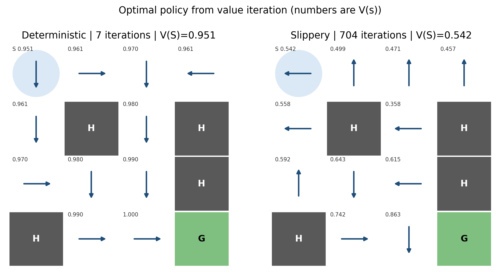
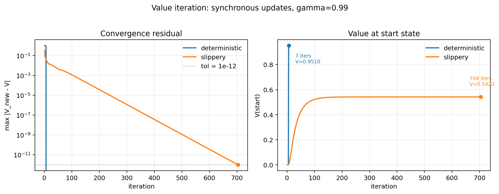
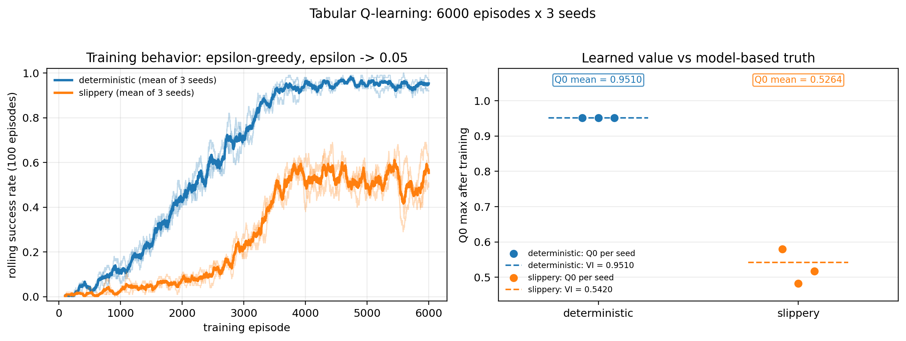

# W7 零基础讲义：一个程序如何在冰面上学会走路

> **写给谁**：完全没学过强化学习，也不需要会推导公式。
> **读完能做什么**：能讲清这周做了什么、三张图怎么看、两个坑为什么重要，并能回答 10 分钟汇报中的常见追问。
> **怎么读**：每节按“专业结论 → 直观辅助 → 精确口径 → 实验读数”组织。类比只用于建立直觉，正文同时给出正式术语和公式，文末另附可直接用于汇报的专业表述。
> **配套文件**：正式报告 `notes/W7_RL报告.md`；三张图 `outputs/w7/`；原始数据 `outputs/w7/*.csv`。

---

## 0. 开场：先把所有术语放下

忘掉 Q-learning、MDP、价值函数这些词。先想象一个画面：

> 湖面结了冰。你站在**左上角**，礼物放在**右下角**。
> 冰面上有 4 个窟窿，掉进去就结束。
> 更麻烦的是，冰很滑：你想往下走，身体可能横着溜出去。

把它画成格子：

```text
S  ·  ·  ·         S = 你站的地方
·  ○  ·  ○         ○ = 窟窿
·  ·  ·  ○         ★ = 礼物
○  ·  ·  ★
```

这周做的事一句话就能说清：

**让一个程序自己学会，在这块冰面上怎么走才能拿到礼物。**

注意“自己”两个字：我们不给它攻略，它一开始什么都不会，乱走、掉窟窿、绕圈子，然后从一次次尝试中慢慢摸出一条路。

这种“从尝试和失败中学决策”的方法，叫**强化学习**。这是全文第一个新名词。现在你已经有它的画面了：一个人在冰上摔了几千次，最后学会走路。

正式地说：强化学习研究一个**智能体（agent）**如何在**环境（environment）**中根据观测选择**动作（action）**，并通过环境返回的**奖励（reward）**调整策略，使长期累积奖励最大化。本实验把冰面形式化为一个马尔可夫决策过程；下一节给出正式定义。

---

## 1. 游戏规则：计算机看到的冰面长什么样

计算机不懂“冰面”和“礼物”。我们要把它翻译成计算机能处理的三件事。

### 1.1 它在哪里？

最简单的办法：把 4×4 的格子从左到右、从上到下编号 0 到 15。

```text
 0   1   2   3
 4   5   6   7
 8   9  10  11
12  13  14  15
```

- 起点：0；
- 窟窿：5、7、11、12；
- 礼物：15。

以后说“状态是 9”，意思就是“它现在站在第三行中间那个格子”。

> **新词卡：状态**  
> 状态 = 我现在在哪。在本实验里就是 0–15 中的一个格子编号。

### 1.2 它能做什么？

每一步只能选一个方向：**左、下、右、上**。就这四个选项。

> **新词卡：动作**  
> 动作 = 我这一步选择往哪走。左=0，下=1，右=2，上=3。

### 1.3 它怎么知道做得好？

打分规则：

- 走到礼物：**1 分**，游戏结束；
- 掉进窟窿：0 分，游戏结束；
- 其他每一步：0 分，继续。

只有终点有分，路上全是 0 分。这叫“稀疏奖励”：奖励像沙漠里的水，非常稀少。

> **新词卡：奖励**  
> 奖励 = 这一步立刻得到的分数。本实验里只有到终点才有 1 分。

### 1.4 一次完整尝试

从起点出发，到拿到礼物、掉窟窿，或者走满规定步数，算一次尝试。本周每次正式实验做 **6000 次尝试**。

> **新词卡：回合**  
> 回合 = 从起点出发的一次完整尝试。一次尝试可能 6 步成功，也可能走满上限仍未成功。

### 1.5 冰面有两种

- **不滑**：你想往哪走，就一定往哪走；
- **滑**：你想走的方向只有 1/3 概率成真，另外 2/3 概率滑到两个垂直方向。

例如站在 0 号格子选“右”：

- 1/3 概率到 1（向右成功）；
- 1/3 概率停在 0（向上撞墙）；
- 1/3 概率到 4（向下滑）。

所以同一个策略在滑面上不一定每次都成功。**这不是程序写错了，是环境本身随机。**

### 1.6 专业定义：MDP 五元组

前面的三件事可以形式化为一个**马尔可夫决策过程（Markov Decision Process, MDP）**：

\[
\mathcal{M}=(\mathcal{S},\mathcal{A},P,R,\gamma)
\]

| 符号 | 专业定义 | 本实验取值 |
|---|---|---|
| \(\mathcal{S}\) | 状态空间 | \(\{0,\ldots,15\}\)，共 16 个 |
| \(\mathcal{A}\) | 动作空间 | \(\{0,1,2,3\}\)，对应左、下、右、上 |
| \(P(s'\mid s,a)\) | 状态转移概率 | 不滑为 0/1；滑面为 1/3、1/3、1/3 |
| \(R(s,a,s')\) | 奖励函数 | 进入终点为 1，否则为 0 |
| \(\gamma\) | 折扣因子 | 0.99 |

> **辅助理解（不用于正式汇报）**：MDP 就是“游戏规则说明书”。  
> **正式口径**：本实验是一个 16 状态、4 动作、带稀疏终点奖励和随机转移的 episodic MDP；洞和终点为吸收终止状态，步数上限作为截断处理。

---

## 2. 核心直觉：为什么“早拿到礼物”更值钱

现在有一个关键问题：

> 6 步拿到 1 分和 60 步拿到 1 分，得分一样吗？

账面上都是 1 分，但直觉上：早到更好。晚了不仅浪费时间，每多走一步就多一次掉窟窿的风险。

我们用一个生活经验来翻译：**今天的一块钱比明天的一块钱值钱**。如果让你选“现在拿 100 元”或“一年后拿 100 元”，你会选现在。折算时，未来的钱要打折。

本实验用的是 **0.99 折**：每多走一步，之后拿到的分都乘以 0.99。

算一笔账：

- 6 步拿到的 1 分：中间隔 5 步，值 `0.99 × 0.99 × 0.99 × 0.99 × 0.99 × 1 ≈ 0.951`；
- 60 步拿到的 1 分：隔 59 步，只值 `0.99⁵⁹ ≈ 0.55`；
- 一直拖着不拿：每拖一步缩水 1%，最终趋近 0。

**所以“打折”自动实现了“越快越好”。**

> **新词卡：折扣**  
> 折扣 = 未来分数打几折。本实验用 0.99。它让程序自然偏爱早成功，而不是无限拖延。

有了折扣，我们可以给出正式定义。

从时刻 \(t\) 开始的**折扣回报（discounted return）**是：

\[
G_t = r_{t+1} + \gamma r_{t+2} + \gamma^2 r_{t+3} + \cdots
\]

策略 \(\pi\) 在状态 \(s\) 下的**状态价值函数**是：

\[
V^\pi(s)=\mathbb{E}_\pi[G_t\mid S_t=s]
\]

在状态 \(s\) 先执行动作 \(a\)、之后按策略 \(\pi\) 行动的**动作价值函数**是：

\[
Q^\pi(s,a)=\mathbb{E}_\pi[G_t\mid S_t=s,A_t=a]
\]

> **辅助理解（不用于正式汇报）**：价值就是“打折后的长期总分”。  
> **正式口径**：本实验的价值是策略在折扣因子 \(\gamma=0.99\) 下的期望折扣回报，不是任务成功率。

在滑面上，价值还必须对各种随机转移取期望，因此它是概率加权平均，而不是某一条轨迹的分数。

---

## 3. 程序怎么学：Q 表与 Q-learning

现在讲这周真正的主角。正式对象是**动作价值函数** \(Q(s,a)\)；因为状态和动作都离散，它可以写成一个 \(16\times4\) 的表格，共 64 个元素。下面用“便利贴”辅助理解这个表。

> **辅助理解（不用于正式汇报）**：每张便利贴写着一个状态-动作对的长期价值。  
> **正式口径**：Q 表是动作价值函数 \(Q:\mathcal{S}\times\mathcal{A}\to\mathbb{R}\) 的表格表示，本实验共 \(16\times4=64\) 个表项。

想象每个“格子 + 方向”的组合都有一张便利贴：

```text
        往左   往下   往右   往上
格子0:  0.00   0.00   0.00   0.00
格子1:  0.00   0.00   0.00   0.00
...（16 个格子 × 4 个方向 = 64 张）
```

便利贴上写的是：

> “站在这个格子、先往这个方向走，长远来看能拿多少打折分？”

一开始全写 0，因为程序什么都不知道。

### 3.1 便利贴怎么改？

每次真走一步，发生三件事：

1. 看到这一步得了几分；
2. 看到了下一格是哪；
3. 瞟一眼下一格那 4 张便利贴里的最大值。

然后把它们拼成一句话：

> 新估计 = 这步得分 + 打折 × 下一格最好便利贴

再用这个新估计去修正当前便利贴。但不是直接覆盖，而是**每次只改 10%**。

正式写成更新式：

\[
Q(s,a)\leftarrow Q(s,a)+\alpha\left[r+\gamma\max_{a'}Q(s',a')-Q(s,a)\right]
\]

其中 \(\alpha=0.1\) 是学习率，方括号里的量叫**时序差分误差（TD error）**。如果下一状态是真正的终止状态，则去掉未来项：

\[
Q(s,a)\leftarrow Q(s,a)+\alpha\left[r-Q(s,a)\right]
\]

为什么只改一点？因为冰面上运气成分很大：这一步可能碰巧走对了，也可能碰巧滑进窟窿。单次采样有方差，小步更新相当于对噪声做平滑。

> **正式口径**：Q-learning 是 off-policy 的时序差分控制算法；它用行为策略采样，用贪心目标 \(r+\gamma\max_{a'}Q(s',a')\) 更新动作价值。

### 3.2 一个具体例子

假设某一步：

```text
这步得分         = 0
下一格最好便利贴   = 0.80
打折            = 0.99
当前便利贴       = 0.50
```

计算：

```text
新估计 = 0 + 0.99 × 0.80 = 0.792
新便利贴 = 0.50 + 10% × (0.792 − 0.50) = 0.529
```

便利贴从 0.50 向 0.792 靠近了一点点。走几千次、每次都这样修，整张表会稳定下来。

> **新词卡：Q 表**  
> Q 表 = 动作价值函数的表格表示，形状 \(16\times4\)。  
> Q-learning 的核心就是：用真实采样得到的 \((s,a,r,s')\) 不断修正这 64 个值。

**这就是 Q-learning。** 名字听起来复杂，但它的动作只有一句话：  
**用即时奖励和下一状态的最优 Q 估计构造 TD 目标，再以小步长更新当前 Q。**

实现位置：`src/mdp_gridworld.py:298-373`。其中 `q_target` 单独负责终止语义，见 `src/mdp_gridworld.py:213-226`。

---

## 4. 两个学生：一个有地图，一个只能用脚试

本周其实做了两套学习，它们的区别用一个比喻就能讲清。

> **学生 A：有地图**  
> 他拿到了完整冰面地图，包括“每个方向有多大概率滑到哪”。他不用下冰面，坐在暖气房里反复推演，就能精确算出每张便利贴。
>
> **学生 B：没有地图**  
> 他不知道冰会往哪滑，只能自己下去走，走一步改一张便利贴。

- 学生 A 的方法叫**值迭代（value iteration）**，属于有模型规划；
- 学生 B 的方法就是刚才的 **Q-learning**，属于无模型时序差分控制。

> **辅助理解（不用于正式汇报）**：一个有地图，一个只能试走。  
> **正式口径**：值迭代在已知 \(P,R\) 下对 Bellman 最优算子做同步备份；Q-learning 不访问 \(P\)，只从采样转移中估计同一个最优动作价值函数。

值迭代的更新式是：

\[
V_{k+1}(s)=\max_{a}\sum_{s'}P(s'\mid s,a)\left[R(s,a,s')+\gamma V_k(s')\right]
\]

当相邻两轮价值的最大变化满足下式时停止：

\[
\lVert V_{k+1}-V_k\rVert_\infty<\text{tol}
\]

本实验取 \(\text{tol}=10^{-12}\)。在 \(\gamma<1\) 时，Bellman 最优算子是压缩映射，因此同步值迭代会收敛到唯一不动点 \(V^*\)。实现见 `src/mdp_gridworld.py:123-152`。

### 4.1 为什么两个都做？

因为学生 A 的结果可以作为**参考答案**：

> 如果学生 B 靠实践摸出来的便利贴，和学生 A 精确算出来的便利贴对得上，我们就有较强理由相信学生 B 的实现没写错。

这就像考试后对参考答案：对上了不证明你是天才，但能证明你没算错。

### 4.2 对上了吗？

结果非常好。

**不滑冰面：**

| 学生 B 三次独立学习 | 学生 A 精确答案 | 结论 |
|---|---|---|
| 0.951 / 0.951 / 0.951 | 0.9510 | **完全重合** |

**滑冰面：**

| 学生 B 三次独立学习 | 学生 A 精确答案 | 结论 |
|---|---|---|
| 0.580 / 0.482 / 0.517 | 0.5420 | 平均 0.526，差 0.016 |

不滑时三次答案和参考答案**一位小数都不差**。这是两个独立实现之间的一致性证据。

> **正式口径**：模型型值迭代与无模型 Q-learning 在相同 \(\gamma\)、奖励和终止语义下估计同一最优价值函数；两者一致支持实现正确，但不能排除共享的环境建模错误，因此还需要单元测试和错误对照。

---

## 5. 必须纠正的一个直觉：0.951 不是“95% 成功率”

看到不滑冰面的答案是 0.951，很容易误读成“成功率 95%”。

**错。** 这是全周最值得单独讲的一节。

回忆第 2 章：6 步拿到 1 分，打折后值 0.951。但在不滑冰面上，最优走法**每一次**都能走完这条 6 步路——**成功率是 100%**。

```text
0.951 = 打折后的分数
100%  = 能不能走到的比例
```

两个数字回答两个不同的问题：

- **分数**回答：拿到奖励时打了多少折？越早到越值钱；
- **成功率**回答：限定步数内到没到？不关心早晚。

在滑冰面上也一样：答案 0.542 是“打折后的期望分数”，不是 54% 成功率。实际测出来，在 100 步上限内成功率约 **73%**。

在只给终点奖励的稀疏 MDP 中，若首次到达终点所需动作数为 \(T\)，则两者的严格定义是：

\[
V^\pi(0)=\mathbb{E}_\pi\left[\gamma^{T-1}\mathbf{1}(T<\infty)\right],
\qquad
\mathrm{Success}_H^\pi=\Pr{}_\pi(T\le H)
\]

前者对到达时间做折扣，后者只统计是否在 H 步内到达。二者只有在特定条件（例如 \(\gamma=1\) 且无限时域）下才可能对应。

> **辅助理解（不用于正式汇报）**：价值看“打折后的分数”，成功率看“限时内到没到”。  
> **正式口径**：本实验报告的 \(V(0)\) 是 \(\gamma=0.99\) 下的期望折扣回报；成功率是独立评估在给定步数上限 H 内的任务成功率，二者不可互相替代。

### 5.1 为什么训练时约 95%，考核时却是 100%？

数据里还有一个容易困惑的对比：

- 训练最后 500 次成功率约 **95%**；
- 训练结束后正式考核，成功率却是 **100%**。

为什么考核反而更高？

因为训练时为了探索，程序会故意留 5% 的机会随机乱走；乱走会掉窟窿，所以训练成绩被压低。**考核时关掉随机探索**，每一步都选当前最好的方向，不滑冰面上自然每次都能走到。

正式地说，训练使用 \(\varepsilon\)-greedy 行为策略：

\[
\pi_{\text{train}}(a\mid s)=
\begin{cases}
1-\varepsilon+\varepsilon/|\mathcal{A}|, & a=\arg\max_{a'}Q(s,a')\\
\varepsilon/|\mathcal{A}|, & \text{otherwise}
\end{cases}
\]

评估使用确定性贪心策略 \(\pi_{\text{eval}}(s)=\arg\max_a Q(s,a)\)，即 \(\varepsilon=0\)。这两个策略不同，所以训练阶段成功率与最终贪心成功率不能混用。

> **新词卡：探索与利用**  
> 探索 = 以概率 \(\varepsilon\) 采样非贪心动作，避免局部最优；利用 = 选择当前 Q 最大的动作。训练需要探索，最终评估通常只测贪心策略。

---

## 6. 第一个大坑：终止语义与截断语义

到目前为止一切美好。现在讲这周最“值钱”的发现。

### 6.1 两种结束在数学上不同

在 Gymnasium 接口中，回合结束被拆成两个布尔量：

- `terminated`：进入真正的吸收终止状态；
- `truncated`：达到人为步数上限，但 MDP 并未进入终止状态。

对应的 TD 目标不同：

\[
y_t=
\begin{cases}
r_{t+1}, & \text{terminated}=1\\
r_{t+1}+\gamma\max_{a'}Q(s_{t+1},a'), & \text{truncated}=1
\end{cases}
\]

| 结束原因 | 专业含义 | TD 目标是否保留未来 | 辅助比喻 |
|---|---|---|---|
| 拿到礼物 / 掉窟窿 | `terminated=True` | 不保留，\(y=r\) | 考试交卷 |
| 规定步数用完 | `truncated=True` | **保留**，\(y=r+\gamma\max Q\) | 时间到收卷 |

第二种只是采样过程被截断，状态转移并没有进入终止状态。因此下一状态的价值估计仍然有效，不能丢弃。

### 6.2 bug 怎么写

回忆便利贴的更新：

> 新估计 = 这步得分 + 打折 × **下一格最好便利贴**

关键在最后一截：**只有真的交卷时，才应该去掉“下一格”部分**。如果只是时间到，后面明明还有路，去掉它就等于告诉程序一个谎：“此地已无未来。”

这个 bug 很小，就是把两种结束合并成同一种。对应到实际代码：

```python
# 正确
done_for_bootstrap = terminated
target = r + gamma * Q[s2].max() * (1 - done_for_bootstrap)

# 错误：把时间截断也当成终止
done = terminated or truncated
target = r + gamma * Q[s2].max() * (1 - done)
```

实现中把这段逻辑封装在 `q_target()`（`src/mdp_gridworld.py:213-226`），并用 `bootstrap_truncated` 参数切换正确/错误版本，保证对照实验只改这一处。

### 6.3 后果有多严重？

在滑冰面上做对照实验，限 20 步，三个独立种子取平均：

| 写法 | 学到的起点价值 | 相对参考答案 0.542 | 考核成功率 |
|---|---|---|---|
| 正确 | 0.566 | 104%（正常浮动） | 19.2% |
| **错误** | **0.168** | **只剩 31%** | 14.1% |

价值被砍到只剩三成。但最吓人的是最后一列：**成功率只从 19.2% 降到 14.1%，没有崩盘。**

### 6.4 为什么说这是最贵的 bug

它**不报错**。程序照常跑完，曲线照常画出来，成功率看起来还行。你把图给别人看，别人不会说“这有问题”。

可便利贴已经系统性说谎了——它以为“走到第 20 步，世界就消失了”。以后你拿这张表做任何规划，地基都是歪的。

> **这类“跑得通但悄悄错”的 bug，比崩溃难抓一百倍。**  
> 崩溃你会去修；不崩溃的错，会让你自信地把错误结论写进报告。

### 6.5 这个结论能不能直接搬到 W5 机械臂？

不能照搬“偏低”这个方向。

本实验分数非负，错误地砍掉“未来”等于砍掉正值，所以价值变低。但 W5 的 FetchReach 奖励是失败扣 1 分、成功 0 分，分数非正；砍掉“未来”砍掉的是负数，结果反而可能**虚高**。

> **规则通用：时间截断仍应 bootstrap。**  
> **方向不通用：变低还是变高，取决于奖励的符号。**

> **正式口径**：`terminated` 表示进入吸收终止状态，价值目标应截断；`truncated` 只表示采样时域上限到达，若任务仍可继续，应保留 bootstrap 项。错误合并两者会改变 Bellman 目标，造成系统性价值偏差。

---

## 7. 第二个大坑：奖励设计与目标错位

最后一个实验讲一种更隐蔽的错误：**优化目标写错后，智能体可以提高回报，却完不成任务。**

### 7.1 两种奖励函数

正式地写，两种奖励分别是：

\[
R_{\text{sparse}}(s,a,s')=\mathbf{1}[s'=G]
\]

\[
R_{\text{hacked}}(s,a,s')=0.1\cdot\mathbf{1}[d(s')<d(s)]
\]

其中 \(d(s)\) 是状态到终点的 Manhattan 距离。前者只在到达终点时给 1；后者在距离减小时给 0.1，离终点更远不罚，到达终点也没有额外奖励。

任务评价不读取奖励函数，而是独立定义：

\[
J_{\text{task}}=\Pr(\text{在 H 步内到达终点})
\]

这就形成了一个**目标错位**：训练最大化 \(R_{\text{hacked}}\) 的折扣回报，验收却看 \(J_{\text{task}}\)。

> **辅助理解（不用于正式汇报）**：奖励是“训练时给程序看的分数”，成功率是“任务真正要求的结果”。  
> **正式口径**：该对照固定环境、训练预算和评估协议，只改变奖励函数，用于检验 agent 是否会利用稠密奖励漏洞产生 reward hacking。

### 7.2 对照结果

滑冰面，限 50 步，三个种子平均：

| 打分规则 | 训练平均分 | 真正拿到礼物的比例 |
|---|---|---|
| 到终点给 1 分 | 0.42 | **52.8%** |
| 变近就给 0.1 分 | **1.19**（更高） | **0%** |

**分数更高，任务完成率是零。**

程序发现了规则漏洞：在礼物附近**来回溜达**——滑近一步得 0.1，滑远不扣分，再滑近又得 0.1。一局 50 步能刷 1 分多，比真去拿礼物（才 1 分）更划算。于是它**完美学会了刷分，顺便完美地不去终点**。

> **新词卡：reward hacking（奖励作弊）**  
> 程序严格提高了你写下的分数，却没有完成你心里想让它做的事。  
> 它不是恶意作弊，而是你把目标写歪了。

### 7.3 和第 6 章是同一件事的两面

- 第 6 章：**目标是对的，代码抄错了**（把“时间到”写成“真结束”）；
- 第 7 章：**代码是对的，目标写歪了**（把“到达”写成“变近”）。

两个坑的共同点：**程序不报错，只有专门设计的对照实验能抓到。** 这就是为什么本周故意做了两组“错误版”实验——证明正确版和错误版确实拉出了差距。

> **正式口径**：稀疏奖励与稠密距离奖励属于不同的优化目标，其回报数值不在同一量纲上，不能直接比较“谁更高”。跨奖励设计只能比较同一任务评价指标（成功率）以及行为差异；回报只用于解释优化过程。

---

## 8. 三张图怎么看

图都在 `outputs/w7/`。汇报时按下面的顺序讲。



### 8.1 `policies.png`：学到的走路攻略

左右两块冰面，每个格子一个**箭头**，表示“这个格子应该往哪走”。格子里的小数字是这格的价值，越靠近礼物数字越大。

**左边（不滑）**：箭头串起来就是 6 步最短路——下、下、右、下、右、右。汇报时可以说：“它自己摸出了最短路。”

**右边（滑）**：箭头看起来有点怪，起点甚至指“左”。为什么？因为它算的不是“想往哪走”，而是“哪个意图在概率上更安全”。冰会把你带偏，直觉上的直路反而危险，它宁可绕远。

> ⚠️ 滑冰面上的箭头是“意图”，不是“实际去向”。你按三次“左”，可能一路向下——箭头只代表你按了什么，不代表你去到哪。



### 8.2 `vi_convergence.png`：有地图的学生算得有多快

左右两个子图，横轴都是计算轮数。

- 左图：本轮和上一轮答案的最大差距，越低越稳定。纵轴是对数刻度——每往下一格，差距缩小 10 倍；
- 右图：起点价值如何逐渐逼近最终答案。

关键读数：

| 冰面 | 收敛轮数 | 最终起点价值 |
|---|---|---|
| 不滑 | **7 轮** | 0.9510 |
| 滑 | **704 轮** | 0.5420 |

为什么差 100 倍？不滑时信息沿最短路传回来，6 轮传到起点；滑时每步裂成三个去向，价值要靠大量路径平均才能稳定。

图上还有个不显眼但值得讲的细节：橙色线从第 200 轮到 704 轮，答案只从 0.5414 爬到 0.5420。**后面 500 轮磨的只是小数点后第四位**。“704 轮收敛”是在极苛刻精度下的结果，不代表每一轮都有大幅学习。



### 8.3 `q_learning.png`：靠脚试的学生学得怎么样

左边是训练过程，右边是最终答案。

**左边**：

- 横轴：训练次数，从 100 到 6000；
- 纵轴：最近 100 次的平均成功率；
- 蓝色：不滑；橙色：滑；
- 细线：三个独立种子的各自表现；粗线：三者平均。

关键拐点：

| 训练次数 | 不滑平均成功率 | 滑面平均成功率 |
|---:|---:|---:|
| 100 | 0.003 | 0.003 |
| 1000 | 0.110 | 0.027 |
| 2000 | 0.423 | 0.077 |
| 3600 | 0.930 | 0.467 |
| 6000（最后 100 次） | 0.953 | 0.553 |

一开始几乎全乱走，所以成功率接近 0；随着探索比例下降、经验增多，成功率快速上升。

> ⚠️ 最后一个点只统计最后 100 次，噪声较大。正式报告用的是最后 500 次的平均，不滑约 0.948，滑面约 0.493。**不要把图上最后一个点当成稳定性能。**

**右边**：

- 圆点：三个种子各自学到的起点价值；
- 虚线：值迭代的参考答案；
- 不滑：三个圆点完全和虚线重合；
- 滑面：三个圆点在 0.48–0.58 之间散开，平均 0.526，接近虚线 0.542。

---

## 9. 实验设计与可信度

一个数字要有可信度，首先要固定实验协议，再回答四个问题。

### 9.0 固定协议

| 项目 | 设置 |
|---|---|
| 环境 | 16 状态、4 动作、稀疏终点奖励的 episodic gridworld |
| 训练算法 | 表格 Q-learning，行为策略为 \(\varepsilon\)-greedy |
| 超参数 | \(\alpha=0.1\)，\(\gamma=0.99\)，训练 6000 episodes |
| 探索调度 | \(\varepsilon\) 从 1.0 在 3600 episodes 内线性降至 0.05，之后固定 0.05 |
| 训练种子 | 0 / 1 / 2 |
| 评估策略 | \(\varepsilon=0\) 的贪心策略 |
| 评估回合 | 500 个独立测试种子，10000–10499 |
| 步数上限 | D2：100；C1：20；C2：50 |
| 原始数据 | `outputs/w7/summary.csv`、`q_training_curves.csv` |

以下四项分别检查：参考答案、随机波动、评估公平性、关键语义。

### 9.1 有没有参考答案？

有。值迭代在已知地图下精确计算，且两个已知数值完全复现：

- 不滑 7 轮 / 0.9510；
- 滑面 704 轮 / 0.5420。

### 9.2 会不会只是运气好？

不会只看一次。每个正式实验跑 **3 个独立训练种子**，原始值全部保留。滑面三次分别是 0.580 / 0.482 / 0.517，差距看得见；我们报告均值，也报告每一个原始值，不挑最好的。

> **新词卡：随机种子**  
> 种子 = 伪随机数生成器的初始状态。固定种子可以复现同一条随机数流；更换种子相当于重复一次独立训练。

### 9.3 评估公平吗？

考核用固定的 **500 个独立测试回合**，所有策略面对同一组测试条件，且考核时关掉随机探索。训练用种子 0/1/2，测试用另一组种子，测试条件从未参与调参。评估实现见 `src/mdp_gridworld.py:385-427`。

### 9.4 关键行为有没有单独检查？

有。全仓 **32 个单元测试**通过，专门检查边界移动、滑面概率、终止状态、终止语义和最短路径。另外两组“故意写错”的实验证明：错误版确实产生了方向一致的破坏。

### 9.5 交叉证据是不是绝对证明？

不是。如果奖励函数本身写错，值迭代和 Q-learning 可能一起错。所以交叉验证只是证据之一，还要靠单元测试、错误对照和明确局限。

---

## 10. 结论：这周真正学到了什么

### 10.1 关于该 gridworld 任务

1. 确定性环境下，Q-learning 与值迭代的起点价值完全一致，均为 0.951；贪心成功率 100%。
2. 随机滑面下，三次 Q-learning 的均值 0.526，接近值迭代参考值 0.542；贪心成功率 73.2%。
3. 将 `truncated` 错误并入 `terminated` 后，价值从 0.566 降至 0.168，仅为参考值的 31%。
4. 将稀疏终点奖励替换为距离塑形奖励后，训练回报从 0.42 升至 1.19，但成功率从 52.8% 降至 0。

### 10.2 关于方法（以后遇到任何 RL 项目都适用）

1. **价值不是成功率。** 价值带折扣，成功率带步数上限；
2. **训练成功率不等于最终成功率。** 训练有探索，考核关探索；
3. **时间截断仍要保留未来。** 这是通用规则；
4. **偏差方向取决于奖励符号。** 正奖励下可能低估，负奖励下可能高估；
5. **奖励是优化信号，成功率才是任务验收。** 两者不一致时，程序一定站在奖励那边。

### 10.3 一句话总结

> **这周学到的不是 30 行 Q-learning 代码，而是：一个程序“跑通了、分数也不低”，仍然可能在价值目标或奖励目标上悄悄错掉。必须把口径分开、留下原始数据、做错误对照，才敢说结论可信。**

---

## 11. 局限与自测

### 11.1 局限

| 局限 | 意味着什么结论不能说 |
|---|---|
| 只有 16 个格子 | 不能外推到连续机械臂、视觉输入 |
| 每个条件只跑 3 个训练种子 | 不能说“任意种子都会得到同样精度” |
| 测试 500 回合 | 成功率有约 ±2 个百分点的采样误差 |
| 只测一种错误奖励 | 不能代表所有 reward hacking 形态 |
| 只有表格 Q-learning | 不能推断深度 RL、PPO 的表现 |
| 本周没跑 FetchReach RL | 机械臂负奖励下的方向只是推断，不是实测 |

### 11.2 自测题

先自己回答，再看答案。

1. 为什么 6 步拿到的 1 分值 0.951，不是 1？
2. 0.542 能说成 54% 成功率吗？
3. 为什么训练时 95%，考核时 100%？
4. `terminated` 和 `truncated` 在 TD 目标上有什么区别？
5. 为什么错误终止处理让价值变低？
6. 这个“变低”能直接搬到 FetchReach 吗？
7. 为什么“变近给 0.1”会让成功率变成 0？
8. 为什么说不滑 Q0 完全命中值迭代只是交叉证据？
9. 如果只报告三个种子里最好的那个，会有什么问题？
10. 汇报时如果只能说一句话，你会说什么？

<details>
<summary>参考答案</summary>

1. 中间隔了 5 步，1 分打了 5 次 0.99 折；
2. 不能。0.542 是折扣后的期望分数；实际 100 步内成功率约 73%；
3. 训练保留 5% 随机探索，会掉窟窿；考核关掉探索；
4. 真结束没有下一格，去掉未来；时间到仍有下一格，必须保留未来；
5. 本实验奖励非负，错误切断未来等于砍掉正值，价值被压低；
6. 不能。FetchReach 奖励非正，砍掉未来可能让价值虚高；
7. 在目标附近来回滑动可以反复拿“变近”分，不去终点更划算；
8. 如果奖励或环境写错，两个方法可能一起错；所以还要单测和错误对照；
9. 会掩盖另外两个种子更低的结果，制造“每次都很准”的假象；
10. “价值、成功率、终止、奖励必须分开检查，否则程序可能跑通但结论是错的。”

</details>

---

## 12. 汇报准备

### 12.0 逐章专业表述（正式汇报直接使用）

| 内容 | 专业表述 |
|---|---|
| 任务 | 在一个 16 状态、4 动作的 gridworld MDP 上研究有模型与无模型价值学习，并检验终止语义和奖励设计错误。 |
| MDP | 状态空间大小 16，动作空间大小 4，转移在不滑与随机滑面两种设置下切换，奖励为稀疏终点奖励，折扣因子 \(\gamma=0.99\)。 |
| 值迭代 | 在已知 \(P,R\) 下同步应用 Bellman 最优算子，以 \(\lVert V_{k+1}-V_k\rVert_\infty<10^{-12}\) 为停止条件。 |
| Q-learning | 表格型、off-policy 时序差分控制；行为策略为 \(\varepsilon\)-greedy，目标为 \(r+\gamma\max_{a'}Q(s',a')\)。 |
| 主结果 | 不滑环境 Q-learning 的 \(Q_0=0.950990\)，与值迭代一致；随机滑面 \(Q_0\) 均值 0.5264，均值绝对误差 0.0157，贪心成功率 366/500。 |
| 终止语义 | 将 `truncated` 错误地并入 `terminated` 后，随机滑面 \(Q_0\) 均值降至 0.1684，仅为参考值的 31.1%，但 H=20 成功率未同步归零。 |
| 奖励设计 | 使用距离塑形奖励后，训练不折扣回报由 0.4167 升至 1.1877，但任务成功率由 52.8% 降至 0%，构成 reward hacking。 |
| 可信度 | 三种训练种子、500 个未参与调参的测试回合、显式终止语义单元测试和两组错误对照。 |
| 局限 | 结论限于离散小状态空间和表格方法，不外推到连续控制、视觉策略或深度 RL。 |

> 以上是汇报语言。正文中的冰面和便利贴只用于建立直觉，不应直接出现在正式汇报中。

### 12.1 一页纸摘要（专业版）

1. **研究问题**：在 16 状态、4 动作的 gridworld MDP 上，检验无模型表格 Q-learning 的价值估计、终止语义和奖励设计。
2. **方法**：以有模型值迭代为参考，比较 Q-learning 在确定性与随机滑面下的 \(Q_0\) 和任务成功率，并设置两组故意错误的对照。
3. **主结果**：不滑环境 \(Q_0=0.950990\) 与值迭代一致；随机滑面 \(Q_0\) 均值 0.5264，均值误差 0.0157，贪心成功率 73.2%。
4. **关键错误**：把 `truncated` 混同 `terminated` 使价值降至参考值的 31.1%；使用距离塑形奖励使训练回报升高但成功率为 0。
5. **结论**：价值、任务成功率、终止语义和奖励目标必须分别定义和验证；实现一致性只是证据之一。

### 12.2 三个必答题（专业版）

**做了什么？**  
构建了一个 16 状态、4 动作的离散 MDP，实现同步值迭代和表格 Q-learning；在相同 \(\gamma\)、奖励和终止语义下做价值一致性检验，并设置终止语义与奖励设计两组错误对照。

**结果多好？**  
确定性环境下 Q-learning 收敛到与值迭代相同的 \(Q_0=0.950990\)，贪心成功率 500/500；随机滑面下 \(Q_0\) 三种子均值为 0.5264，与参考值 0.5420 相差 0.0157，贪心成功率为 366/500。

**凭什么信？**  
采用固定随机种子和独立测试回合，分别报告三种子原始结果和 500 回合评估；关键 MDP 转移、终止语义和策略路径有单元测试；错误对照显示两类 bug 都产生了可测的行为或价值偏差。

### 12.3 3 分钟专业汇报稿

> 本实验在 4×4 离散网格 MDP 上比较有模型值迭代与无模型表格 Q-learning。环境包含 16 个状态、4 个动作、洞和终点两类终止状态，以及步数截断；奖励为仅在终点获得的稀疏奖励，折扣因子为 0.99。  
>   
> 方法上，我用值迭代计算参考最优价值，再用 \(\varepsilon\)-greedy 行为策略训练 Q-learning，并用三个训练种子和 500 个独立测试回合评估贪心策略。确定性环境下，Q-learning 的起点价值与值迭代完全一致，均为 0.950990，成功率 500/500。随机滑面下，Q-learning 的三种子均值 0.5264，对值迭代 0.5420 的均值误差为 0.0157，贪心成功率 73.2%。  
>   
> 在此基础上，我做了两个错误对照。第一，把时间截断 `truncated` 当成真正终止 `terminated`，会使价值降至参考值的 31.1%，但短步数成功率不一定同步下降。第二，把终点稀疏奖励改成距离塑形奖励，训练回报由 0.4167 升到 1.1877，但成功率从 52.8% 降到 0%。  
>   
> 因此，本实验的核心结论不是某个具体成功率，而是：价值与成功率、训练与评估、终止与截断、优化奖励与任务目标必须分别定义和验证。结论目前限于离散小状态空间和表格方法。

### 12.4 10 分钟汇报提纲（专业版）

| 时间 | 内容 | 讲述重点 |
|---:|---|---|
| 0:00–1:00 | 研究问题 | 在离散 MDP 上比较有模型与无模型价值学习，并检验两个 silent bug |
| 1:00–3:00 | 方法 | Bellman 最优方程、同步值迭代、表格 Q-learning、固定评估协议 |
| 3:00–5:00 | 主结果 | \(Q_0\) 与值迭代一致；随机滑面均值误差 0.0157；成功率 73.2% |
| 5:00–7:00 | 终止语义 | 错误合并 `terminated`/`truncated` 导致价值降至 31.1%，短程成功率可能掩盖 |
| 7:00–8:30 | 奖励设计 | 塑形奖励使训练回报升高但任务成功率为 0，构成 reward hacking |
| 8:30–10:00 | 可信度与局限 | 三种子、500 独立回合、单测、错误对照；不外推到连续控制 |

### 12.5 常见追问 Q&A

**Q1：为什么不用更大的环境？**  
本周目标是验证价值更新和两类语义错误，小状态空间能获得精确的模型型参考值，也便于控制变量。连续控制会引入函数逼近误差，不利于隔离终止语义和奖励设计的影响。

**Q2：为什么训练成功率比考核低？**  
训练保留 5% 随机探索，会掉窟窿；考核关掉探索。

**Q3：为什么说 0.542 不是 54% 成功率？**  
0.542 是 \(\gamma=0.99\) 下的期望折扣回报；成功率是给定 H 内首次到达的概率，不做折扣。二者定义不同，不能直接换算。

**Q4：终止语义错误为什么严重？**  
它让程序以为“时间到”就是“世界消失”，于是系统性丢掉未来价值；程序仍能跑，但不报错。

**Q5：错误终止为什么可能不影响成功率？**  
成功率是有限步数内的粗指标；价值错误可能先体现在价值表，不一定立刻体现在短程行为上。

**Q6：FetchReach 上也会低估吗？**  
不一定。它的奖励是 `-1/0`，非正；砍掉未来砍掉的是负数，可能反而高估。规则通用，方向不通用。

**Q7：为什么错误奖励的训练分更高？**  
它学会了在目标附近来回刷“变近”分；训练分是优化信号，不是任务验收。

**Q8：为什么不只报均值？**  
三个种子分别是 0.580 / 0.482 / 0.517，只报均值会掩盖波动；可信报告要保留原始值。

**Q9：交叉验证能不能证明代码绝对正确？**  
不能。两个方法可能共享同一个环境或奖励错误，所以还要单测和错误对照。

**Q10：结论能推广到真实机器人吗？**  
具体数值不能。可迁移的是方法：分离口径、独立评估、保留种子、检查终止语义、审视奖励设计。

---

# 附录 A：进阶术语表

这里不是让你先背的，而是读完全文后查阅用。

| 术语 | 英文/记号 | 一句话解释 | 在本实验中 |
|---|---|---|---|
| 强化学习 | Reinforcement Learning, RL | 智能体从交互反馈中学习决策 | 程序在网格中学习路径 |
| 马尔可夫决策过程 | Markov Decision Process, MDP | 用状态、动作、转移、奖励、折扣描述序贯决策 | 16 状态、4 动作网格 |
| 回合 | Episode | 从 reset 到终止或截断的一次完整交互 | 最多 H 步 |
| 状态 | State, \(s\) | 当前局面 | 格子编号 0–15 |
| 动作 | Action, \(a\) | 当前可选行为 | 左/下/右/上 |
| 转移核 | Transition kernel, \(P(s'\mid s,a)\) | 动作后落到各状态的概率分布 | 不滑确定；滑面 1/3 分流 |
| 奖励函数 | Reward function, \(R(s,a,s')\) | 一步交互返回的标量反馈 | 进入终点为 1 |
| 折扣回报 | Discounted return, \(G_t\) | 从当前时刻起的折扣奖励和 | \(\sum_k\gamma^k r_{t+k+1}\) |
| 折扣因子 | Discount factor, \(\gamma\) | 未来奖励的折现率 | 0.99 |
| 策略 | Policy, \(\pi(a\mid s)\) | 状态到动作的映射或分布 | 贪心/\(\varepsilon\)-greedy |
| 状态价值 | State value, \(V^\pi(s)\) | 从状态出发的期望折扣回报 | 起点价值 |
| 动作价值 | Action value, \(Q^\pi(s,a)\) | 先执行动作后的期望折扣回报 | 64 个 Q 表项 |
| 值迭代 | Value iteration | 在已知模型上同步应用 Bellman 最优算子 | 7/704 轮收敛 |
| Q-learning | Tabular Q-learning | 无模型、off-policy 的时序差分控制 | 6000 episodes |
| 自举 | Bootstrapping | 用当前价值估计更新当前价值 | 用 \(Q(s')\) 构造目标 |
| 时序差分误差 | TD error, \(\delta_t\) | 目标与当前估计之差 | \(y_t-Q(s,a)\) |
| 真终止 | `terminated` | 进入吸收终止状态 | 终点或洞 |
| 时间截断 | `truncated` | 达到人为步数上限 | H 步 |
| 奖励作弊 | Reward hacking / specification gaming | 提高代理奖励但偏离真实任务目标 | 距离塑形奖励 |
| 随机种子 | Random seed | 伪随机数流的初始状态 | 0/1/2 与 10000–10499 |

# 附录 B：数据流图

```text
冰面规则
  │
  ├─ 不滑地图 ──────┐
  ├─ 滑面地图 ──────┤
  └─ 奖励规则 ──────┤
                    ▼
              值迭代（有地图）
                    │
        ┌───────────┼───────────────┐
        ▼           ▼               ▼
    起点价值      64张精确表      收敛曲线
        │           │               │
        │           ▼               ▼
        │       策略图          vi_convergence.png
        │
        └──作为参考答案──┐
                        ▼
                 Q-learning（靠尝试）
                        │
              ┌─────────┼─────────┐
              ▼         ▼         ▼
           64张学到的表  训练曲线   独立考核500次
              │         │         │
              ▼         ▼         ▼
          最终价值对比  学习曲线图  成功率/步数
              │         │         │
              └─────────┴────┬────┘
                             ▼
                        summary.csv
                             │
                             ▼
                        三张图 + 报告
```

# 附录 C：如何复现

```bash
cd /home/xiyang/embodied-learning

# 跑全部实验并生成图
./.venv/bin/python scripts/run_w7.py

# 运行测试
./.venv/bin/python -m pytest -q
# 预期：32 passed
```

预期关键输出：

```text
不滑值迭代：7 轮，起点价值 0.950990
滑面值迭代：704 轮，起点价值 0.542026
不滑 Q-learning：三个种子全 0.950990，纯贪心 500/500
滑面 Q-learning：纯贪心 366/500
终止语义错误：价值约 0.168，正确约 0.566
错误奖励：成功率 0/500，正确奖励 264/500
```

# 附录 D：只记住五句话

1. **价值是打折后的分数，不是成功率。**
2. **训练时留探索，考核时关探索。**
3. **真结束切断未来，时间到不切断未来。**
4. **奖励是优化信号，成功率才是任务验收。**
5. **跑得通不等于对，必须有参考答案、独立考核和错误对照。**
